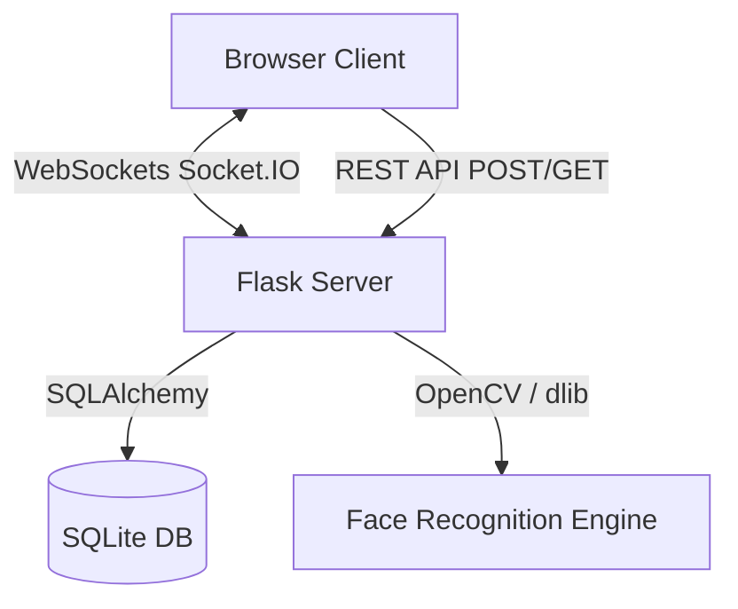

# CPGS FaceID Attendance System — Core Concepts & Code Guide

Welcome to the learning guide for the **Smart Face Attendance System**! This document explains the architecture, libraries, machine learning concepts, real-time streaming pipelines, database layers, and front-end flows used in this project.

---

## 🗺️ Project Architecture Overview

The project uses a hybrid architecture combining a **Flask (Python) backend** with a **Vanilla HTML5/CSS3/JavaScript frontend**. Real-time bi-directional streaming is handled via **WebSockets (Socket.IO)**.



### Directory Structure
- `backend/app.py`: Entrypoint of the Flask server, REST routes, WebSocket event server.
- `models/face_engine.py`: Computer Vision and Machine Learning engine for face detection, encoding, and recognition.
- `models/liveness.py`: Multi-modal passive anti-spoofing pipeline (MiniFASNetV2 ONNX, 2D FFT, LBP, Quality Gate).
- `models/MiniFASNetV2.onnx`: Quantized ONNX neural weights for real-time passive liveness inference via OpenCV DNN.
- `utils/registration.py`: Registration logic (photo ingestion, vector deduplication, database insertions).
- `utils/attendance_manager.py`: Attendance business logic (daily check-ins, check-outs, tardiness, openpyxl Excel exports).
- `database/models.py`: Database models (SQLAlchemy ORM definitions for Student, AttendanceRecord, User; schema migrations).
- `frontend/`: Single-page app resources (HTML5 markup, glassmorphic CSS, WebRTC camera capture, WebSocket client).

---

## 🧠 Core Concept 1: Face Detection & Recognition (Machine Learning)

The face recognition system uses **Deep Learning** pipelines provided by the `dlib` and `face_recognition` libraries.

```
Raw Image  ==[HOG / CNN]==>  Detected Face Box  ==[ResNet-34/Landmarks]==>  128-d Vector
```

### 1. Face Detection (HOG + Linear SVM)
- **Concept**: Finding *where* faces are in an image. The engine uses a **HOG (Histogram of Oriented Gradients)** model. It computes gradient directions in localized regions of the image to build a representation of facial shapes, which are then passed to a Linear SVM classifier.
- **Optimization**: To optimize processing speed, the frames are downscaled by `0.25x` (`scale_factor` in `models/face_engine.py`) before running detection. This speeds up detection by nearly **16x**.

### 2. Face Landmarks & Alignment
- **Concept**: The model identifies 68 specific points (landmarks) on a face (eyes, nose, mouth, jawline) and geometrically aligns the face so that the nose is centered and eyes are level. This ensures variations in head tilt or rotation do not break recognition.

### 3. Face Encoding (Deep Metric Learning)
- **Concept**: The aligned face image is fed into a pre-trained **ResNet-34** deep convolutional network. The network outputs a **128-dimensional floating-point vector** (the face encoding). 
- This vector maps the face into a vector space where **similar faces are close together** and **different faces are far apart**.
- Code detail in `database/models.py`:
  ```python
  face_encoding = Column(Text)  # Serialized 128-d list saved as JSON string
  ```

### 4. Face Matching (Euclidean Distance)
- **Concept**: To recognize a face, we compute the mathematical distance (L2 norm / Euclidean distance) between the detected face's encoding and all known encodings stored in the database.
- **Threshold**: We define a tolerance (`tolerance=0.50`). If the smallest Euclidean distance is below this tolerance, we have a match.
- Code detail in `models/face_engine.py`:
  ```python
  # Compares face_enc with all database known_encodings
  distances = face_recognition.face_distance(self.known_encodings, face_enc)
  best_idx = int(np.argmin(distances))
  if distances[best_idx] < self.tolerance:
      confidence = 1.0 - distances[best_idx] # Convert distance to confidence percentage
  ```

---

## 🎥 Core Concept 2: Real-Time Video Streaming (WebSockets)

Streaming standard HTTP requests (long-polling) is too slow for 25 FPS video. We use **WebSockets** (via Socket.IO) for a permanent bi-directional TCP channel.

```
Webcam Frame (BGR NumPy Array) -> OpenCV Draw Box -> Encode JPG -> Base64 String -> Socket.IO Emit -> Browser 
```

### 1. OpenCV Frame Capture
`cv2.VideoCapture(0)` connects to the default webcam, capturing raw BGR NumPy frames.

### 2. Threading
Because capturing and analyzing frames is CPU-intensive, it runs in a background daemon thread (`CameraManager._loop`) in `models/face_engine.py` so it doesn't block the main Flask web request handlers.

### 3. Base64 Encoding & Socket.IO Emitter
To send frames to the browser, OpenCV encodes the BGR NumPy matrix into a compressed JPEG buffer, which is then serialized into a **Base64 ASCII string** and pushed via WebSockets:
- Code detail in `backend/app.py`:
  ```python
  # Continuously pushes frames to the browser at ~25fps
  socketio.emit('video_frame', {
      'frame': frame_b64,
      'fps': round(camera_mgr.fps, 1)
  })
  ```
- Code detail in `frontend/script.js`:
  ```javascript
  // Receives base64 and binds it to the src of an  tag
  socket.on('video_frame', data => {
    document.getElementById('videoFeed').src = 'data:image/jpeg;base64,' + data.frame;
  });
  ```

---

## 📷 Core Concept 3: WebRTC & Browser Camera Capture

For student registration, instead of uploading a photo file manually, we capture it live using the HTML5 MediaDevices API.

### 1. Starting the Stream
The browser requests permission to access the user's camera stream:
```javascript
regStream = await navigator.mediaDevices.getUserMedia({
  video: { width: 640, height: 480, facingMode: 'user' }
});
document.getElementById('regVideo').srcObject = regStream;
```

### 2. Capturing the Frame via Canvas
To grab a static image, the browser paints the current frame of the `<video>` element onto an offscreen `<canvas>` at full resolution, converts it to a binary JPEG Blob, and wraps it as a standard JavaScript `File` object:
```javascript
const canvas = document.createElement('canvas');
canvas.width = video.videoWidth;
canvas.height = video.videoHeight;
canvas.getContext('2d').drawImage(video, 0, 0, canvas.width, canvas.height);

canvas.toBlob(blob => {
  // Save as selectedPhoto File object, ready for FormData submission
  selectedPhoto = new File([blob], "student_capture.jpg", { type: "image/jpeg" });
}, 'image/jpeg', 0.9);
```

---

## 🗄️ Core Concept 4: Database ORM & Auto-Migration

The backend uses **SQLAlchemy ORM** to interface with a local **SQLite** database file. This hides complex SQL queries behind object-oriented Python code.

### 1. The Student Model
Each student maps directly to a row in the `students` table:
```python
class Student(Base):
    __tablename__ = 'students'
    id = Column(Integer, primary_key=True, autoincrement=True)
    student_id = Column(String(50), unique=True, nullable=False)
    name = Column(String(100), nullable=False)
    batch = Column(String(50))
    # ...
```

### 2. Dynamic Schema Migration
SQLAlchemy's default `create_all(engine)` only builds tables if they are missing; it **cannot** alter columns if the database already exists. 
To add the `batch` column automatically without breaking existing tables, we added an dynamic inspector to modify the schema at startup:
```python
from sqlalchemy import inspect
inspector = inspect(engine)
if 'students' in inspector.get_table_names():
    columns = [c['name'] for c in inspector.get_columns('students')]
    if 'batch' not in columns:
        with engine.begin() as conn:
            conn.exec_driver_sql("ALTER TABLE students ADD COLUMN batch VARCHAR(50)")
```

---

## 🎨 Core Concept 5: Premium CSS Glassmorphism & Themes

The design matches modern premium interface guidelines, utilizing a custom variable styling sheet in `frontend/style.css`:
- **Glassmorphic Panels**: Uses translucent backgrounds backed by blur filters:
  ```css
  --panel: rgba(15, 31, 61, 0.85);
  backdrop-filter: blur(12px);
  ```
- **Responsive Layout**: Uses CSS Grid layouts that dynamically snap from a 2-column sidebar grid to a single column flow on mobile viewports (`@media (max-width: 900px)`).

---

## 💡 Quick Tips for Further Learning

1. **How to adjust facial strictness?**
   Adjust the tolerance value inside `backend/app.py`:
   ```python
   face_engine = FaceRecognitionEngine(tolerance=0.50) # Lower (e.g. 0.40) is stricter; higher (e.g. 0.60) is looser.
   ```
2. **How to change webcam index?**
   If you have multiple webcams connected, modify the index in `backend/app.py`:
   ```python
   camera_mgr = CameraManager(face_engine, camera_index=0) # Change 0 to 1, 2, etc.
   ```
3. **How does SQLite store encodings?**
   SQLite cannot store raw NumPy arrays directly. The application converts the array to a JSON list (`json.dumps(encoding_array.tolist())`) and saves it as text, reversing the conversion upon loading.
