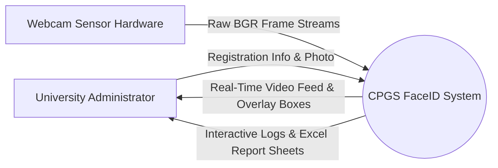
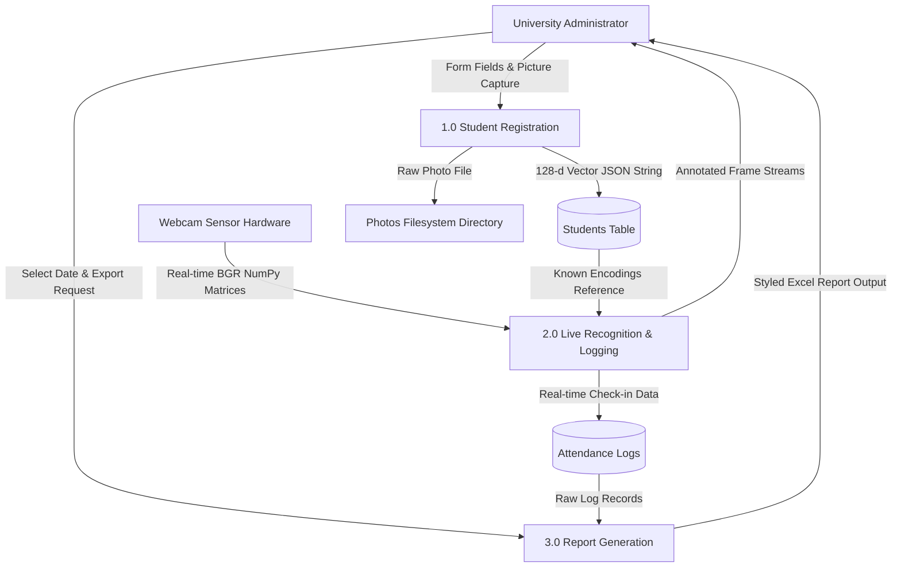
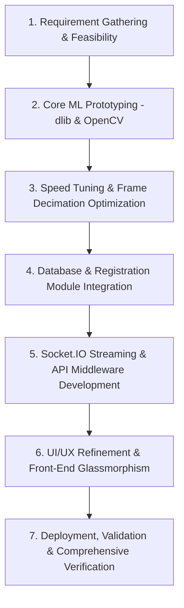
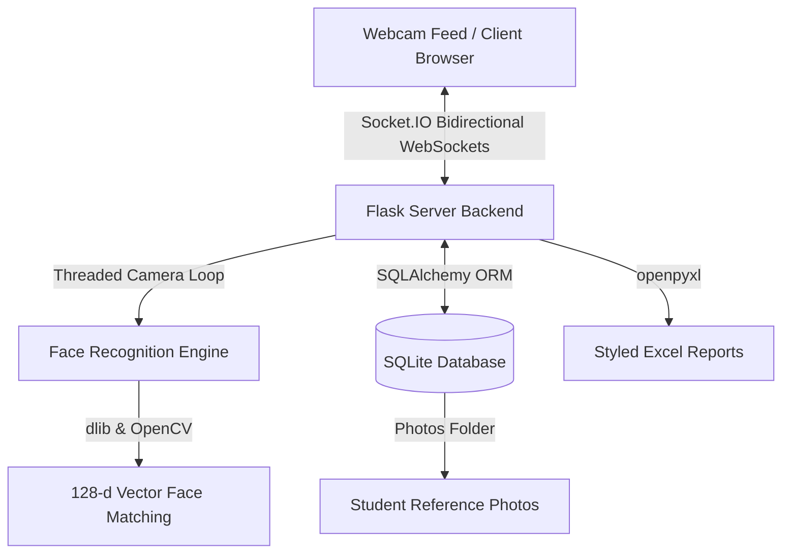
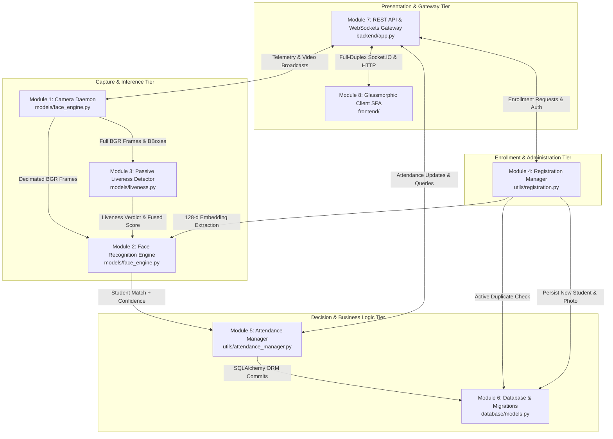
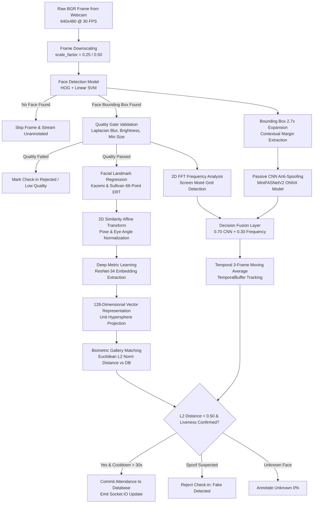
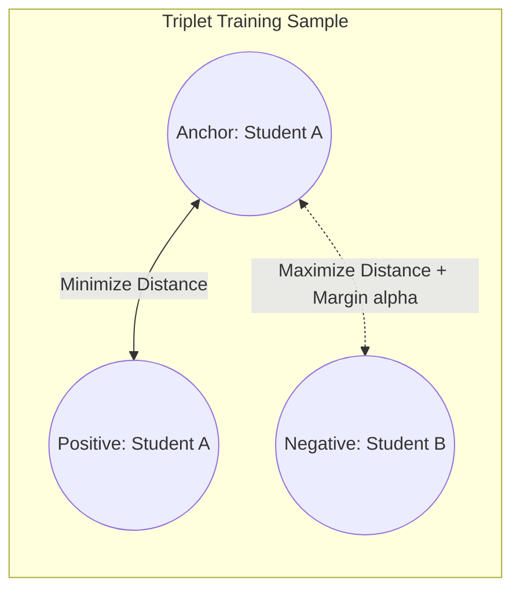

# CPGS Smart FaceID Attendance System
## Project Report & Technical Documentation

---

### **Project Metadata**
* **Project Name:** Smart FaceID Attendance System (CPGS-FaceID)
* **Target Institution:** Centre for Post Graduate Studies (CPGS), Orissa University of Agriculture and Technology (OUAT)
* **Development Language:** Python (Flask Backend), JavaScript (Vanilla Web Frontend)
* **Key Frameworks & Libraries:** OpenCV, Dlib, face_recognition, Flask-SocketIO, SQLAlchemy, openpyxl
* **Database Engine:** SQLite (relational storage with schema auto-migrations)
* **Theme & UI:** Premium Glassmorphism Dark Theme (Responsive Sidebar Navigation)

---

## 📄 Abstract
Traditional attendance management methods, such as paper registers, card scanners, or manual spreadsheets, are slow, error-prone, and susceptible to proxy attendance. The **Smart FaceID Attendance System** is an end-to-end automated software solution designed for **Centre for Post Graduate Studies (CPGS), OUAT** that utilizes computer vision and deep metric learning to mark student attendance automatically. 

By integrating a background camera processing daemon with a WebSockets (Socket.IO) server, the system captures real-time video frames, detects facial landmarks, computes 128-dimensional mathematical representations (encodings), and compares them against database vectors within milliseconds. Additionally, it offers a single-page web dashboard, live WebRTC-based camera registration, and structured exports in custom-styled Excel worksheets complete with data visualization charts.

---

## 📁 Table of Contents
1. [Introduction & Objectives](#1-introduction--objectives)
   - [1.1 Background](#11-background)
   - [1.2 Problem Statement](#12-problem-statement)
   - [1.3 Key Objectives](#13-key-objectives)
   - [1.4 System Study (Feasibility & Comparative Analysis)](#14-system-study-feasibility--comparative-analysis)
   - [1.5 System Analysis (Requirement Analysis & Data Flow Diagrams)](#15-system-analysis-requirement-analysis--data-flow-diagrams)
   - [1.6 Methodology Adopted (Evolutionary Prototyping)](#16-methodology-adopted-evolutionary-prototyping)
2. [System Architecture](#2-system-architecture)
   - [2.1 System Architecture Flow](#21-system-architecture-flow)
   - [2.2 Directory Structure](#22-directory-structure)
   - [2.3 Software Modules & Component Description](#23-software-modules--component-description)
3. [Technology Stack Breakdown](#3-technology-stack-breakdown)
4. [System Specification (Hardware & Software Requirements)](#4-system-specification-hardware--software-requirements)
5. [Database Design & Data Models](#5-database-design--data-models)
6. [Machine Learning Models & Computer Vision Pipeline (Deep Dive)](#6-machine-learning-models--computer-vision-pipeline-deep-dive)
   - [6.1 Architectural Overview of the ML Pipeline](#61-architectural-overview-of-the-ml-pipeline)
   - [6.2 Face Detection: HOG + Linear SVM vs. Modern Deep Detectors](#62-face-detection-hog--linear-svm-vs-modern-deep-detectors)
   - [6.3 Facial Landmark Localization (Kazemi & Sullivan 68-Point ERT)](#63-facial-landmark-localization-kazemi--sullivan-68-point-ert)
   - [6.4 Geometric Face Alignment & 2D Affine Normalization](#64-geometric-face-alignment--2d-affine-normalization)
   - [6.5 Deep Metric Learning & Embedding Generation (ResNet-34)](#65-deep-metric-learning--embedding-generation-resnet-34)
   - [6.6 Loss Function Formulation: Triplet Margin Loss](#66-loss-function-formulation-triplet-margin-loss)
   - [6.7 Biometric Matching: Hypersphere L2 Distance & Similarity](#67-biometric-matching-hypersphere-l2-distance--similarity)
   - [6.8 Duplicate Biometric Prevention during Enrollment](#68-duplicate-biometric-prevention-during-enrollment)
   - [6.9 Passive Anti-Spoofing Model: MiniFASNetV2 Edge CNN (Silent-Face)](#69-passive-anti-spoofing-model-minifasnetv2-edge-cnn-silent-face)
   
   - [6.10 Handcrafted Physical Texture & Frequency Analyzers (2D FFT, Laplacian, LBP)](#610-handcrafted-physical-texture--frequency-analyzers-2d-fft-laplacian-lbp)
   - [6.11 Multi-Stage Decision Fusion & Temporal Moving Average Filter](#611-multi-stage-decision-fusion--temporal-moving-average-filter)
   - [6.12 Comparative Benchmark: Face Recognition & Detection Paradigms](#612-comparative-benchmark-face-recognition--detection-paradigms)
   - [6.13 CPU Acceleration & Real-Time Performance Engineering](#613-cpu-acceleration--real-time-performance-engineering)
7. [System Integration & Application Engineering](#7-system-integration--application-engineering)
   - [7.1 Decoupled Multi-Threaded Camera Daemon](#71-decoupled-multi-threaded-camera-daemon)
   - [7.2 Real-Time Video Streaming (Flask-SocketIO & Base64 Encoding)](#72-real-time-video-streaming-flask-socketio--base64-encoding)
   - [7.3 WebRTC Camera Photo Capture & Registration Engine](#73-webrtc-camera-photo-capture--registration-engine)
   - [7.4 Automated Excel Analytics Report Generator (openpyxl)](#74-automated-excel-analytics-report-generator-openpyxl)
8. [UI/UX & Styling Aesthetics](#8-uiux--styling-aesthetics)
9. [Testing, Validation & Performance Tuning](#9-testing-validation--performance-tuning)
10. [System Limitations, Operational Challenges & Mitigation Strategies](#10-system-limitations-operational-challenges--mitigation-strategies)
    - [10.1 Computer Vision & Biometric Pipeline Limitations](#101-computer-vision--biometric-pipeline-limitations)
    - [10.2 Anti-Spoofing & Passive Presentation Attack Boundaries](#102-anti-spoofing--passive-presentation-attack-boundaries)
    - [10.3 Computational Scalability & Multi-Face Crowding Bottlenecks](#103-computational-scalability--multi-face-crowding-bottlenecks)
    - [10.4 Architectural & Database Scalability Constraints](#104-architectural--database-scalability-constraints)
    - [10.5 Data Privacy, Compliance & Operational Reliability](#105-data-privacy-compliance--operational-reliability)
11. [Conclusion & Future Scope](#11-conclusion--future-scope)
    - [11.1 Conclusion](#111-conclusion)
    - [11.2 Future Scope](#112-future-scope)
12. [References & Bibliography](#12-references--bibliography)
    - [12.1 Academic & Research Papers](#121-academic--research-papers)
    - [12.2 Software Libraries & Technical Frameworks](#122-software-libraries--technical-frameworks)
    - [12.3 Datasets, Benchmarks & Industry Specifications](#123-datasets-benchmarks--industry-specifications)

---

## 1. Introduction & Objectives

### 1.1 Background
Attendance tracking is a critical operational procedure in educational institutions. At CPGS, OUAT, keeping track of postgraduate batches across different departments requires accuracy, speed, and clean documentation. This project leverages modern deep learning models to implement a frictionless, automated check-in process.

### 1.2 Problem Statement
Manual attendance tracking wastes valuable lecture time and is prone to errors and proxy records. Standard facial recognition models run slowly on standard CPU hardware or lack user-friendly interfaces, database backends, and automatic reporting features.

### 1.3 Key Objectives
- **Zero-Touch Attendance**: Recognize students from a live camera feed and log check-ins automatically.
- **Real-Time Visual Feedback**: Update the dashboard statistics, weekly trends, and log records immediately via WebSockets.
- **Convenient Registration**: Allow admins to enroll students using a built-in browser webcam stream or by uploading photo files.
- **Robust Reporting**: Generate rich Excel sheets containing aggregate statistics, individual breakdowns, and visual trend charts.

### 1.4 System Study (Feasibility & Comparative Analysis)

#### 1.4.1 Feasibility Study
Before embarking on the system implementation, a thorough feasibility study was conducted across three major dimensions:

1. **Technical Feasibility**:
   * **Library Maturity**: The project utilizes `dlib` and `face_recognition`, which are built on high-accuracy ResNet models achieving $99.38\%$ accuracy on the Labeled Faces in the Wild benchmark.
   * **Hardware Compatibility**: Standard face detection models are computationally expensive. However, by downscaling frames by $16\times$ (scaling factor of $0.25$) and implementing frame-decimation (processing every 3rd frame), the system is optimized to run smoothly on standard consumer CPUs without requiring dedicated GPU acceleration.
   * **Client Compatibility**: Standard browsers support the HTML5 MediaDevices API (WebRTC), allowing high-resolution frame capture directly through browser clients.

2. **Economic Feasibility**:
   * **Zero License Cost**: The system is built entirely on open-source frameworks (Python, Flask, SQLite, OpenCV, and JavaScript) which eliminates recurring software license fees.
   * **Resource Utilization**: It works on standard office computers and webcams already owned by the university, requiring no capital investment in proprietary hardware clocks or RFID cards.
   * **Operational Savings**: It recovers hundreds of hours of lecture time annually by eliminating verbal roll calls.

3. **Operational Feasibility**:
   * **Frictionless Adoption**: Students do not need training; they simply pass in front of a camera. 
   * **Familiar Reports**: The administrative dashboard generates standard Excel files styled with standard charts and metrics, aligning directly with current university record-keeping policies.
   * **Minimal Maintenance**: Local SQLite storage and automatic SQLAlchemy migrations mean local IT staff can manage the database without active database administrator intervention.

#### 1.4.2 Comparative Analysis (Present vs. Proposed System)

| Feature | Present System (Manual Roll Call) | Proposed System (CPGS-FaceID) |
| :--- | :--- | :--- |
| **Speed** | Slow (takes 5-10 minutes per class session). | Instantaneous (milliseconds per face). |
| **Proxy Attendance**| High risk (students can sign registers for absent peers). | Zero risk (requires unique physical biometric presence). |
| **Human Effort** | High (manual roll calls, manual typing into systems). | Extremely low (automatic detection and automated database storage). |
| **Report Formats** | Paper logs or manually compiled Excel sheets. | Professional, automatic multi-sheet Excel reports with charts. |
| **Real-time Access**| No (records are reviewed at the end of semesters). | Yes (live updates pushed instantly to the administrator dashboard). |
| **Data Integrity** | Prone to human errors, missing sheets, or illegible handwriting. | Stored in structured database with transaction safeguards. |
| **Cost** | High operational time costs; paper waste. | One-time development setup, zero operational expenses. |

### 1.5 System Analysis (Requirement Analysis & Data Flow Diagrams)

#### 1.5.1 Requirement Analysis
To ensure the CPGS-FaceID system meets operational standards, requirements are divided into functional and non-functional specifications.

##### A. Functional Requirements (FR)
- **FR-1 (Automated Face Recognition)**: The system must automatically read real-time webcam frame matrices, detect face locations, extract visual encodings, and verify student identities.
- **FR-2 (Classwise Consecutive Mapping)**: The database registers attendance by hour-long class sessions. If a student checks in for class hour $H$ but fails to check in for the consecutive class hour $H+1$ (meaning they skipped class), an explicit record with status `"Absent"` is automatically registered for hour $H+1$ in the database.
- **FR-3 (Detection Cooldown)**: The system must enforce a 30-second registration cooldown per student after a successful match to avoid transaction flood and redundant logs.
- **FR-4 (Demographics Management)**: The system must enable administrators to enroll students by inputting details (Student ID, Name, Email, Department, Batch) and capturing a photo via WebRTC webcam or a file upload.
- **FR-5 (Active soft-deletion)**: Admins must be able to soft-delete students (setting `is_active = False`) to remove them from recognition loops while preserving their historical database logs.
- **FR-6 (Date-based Queries)**: The admin dashboard must allow query filtration and log inspections by selecting custom dates on a calendar picker.
- **FR-7 (Analytical Excel Generation)**: The system must output highly stylized Excel workbooks containing colorful KPI summary cards, color-coded status tables, aggregate breakdowns, and interactive bar charts.

##### B. Non-Functional Requirements (NFR)
- **NFR-1 (Performance & FPS)**: Annotated video streams must broadcast to client browsers at an average frame rate of $\ge 15$ frames per second under standard CPU execution.
- **NFR-2 (Precision Matching)**: Enforce a mathematical tolerance threshold of $0.50$ (Euclidean distance) to minimize false positive identifications.
- **NFR-3 (Responsive Styling)**: The system interface must load in less than 1.5 seconds and scale automatically to fit varying viewports from desktop screens to mobile screens.
- **NFR-4 (Data Transaction Safety)**: Database queries must execute inside transaction sessions, rolling back changes if a matching image upload fails to save on disk.

#### 1.5.2 Data Flow Diagrams (DFD)
Data Flow Diagrams visually detail how inputs are transformed into data outputs throughout the system's operational lifecycle.

##### Level 0 DFD (Context Diagram)
The Context Diagram represents the high-level boundaries of the system, showing interactions with external entities.



##### Level 1 DFD (Process Decomposition)
The Level 1 DFD decomposes the system into core functional processes: student registration, live face recognition logging, and administrative reporting.



### 1.6 Methodology Adopted (Evolutionary Prototyping)

The project was developed using the **Evolutionary Prototyping Methodology**. This software engineering lifecycle model is highly suited for intelligent systems because it allows developers to build core machine learning capabilities first, iterate based on speed and accuracy constraints, and expand subsystems incrementally.



#### 1.6.1 Phase Breakdown

1. **Phase 1: Requirement Analysis & Technical Assessment**:
   * Analyzed academic requirements at CPGS, OUAT to support check-in logging, batch filters, and Excel reports.
   * Assessed technology tools and chose OpenCV, Dlib, and SQLite as they do not incur external licensing fees.

2. **Phase 2: Core Machine Learning Prototyping**:
   * Built and verified the standalone face recognition engine using the HOG + Linear SVM model inside `models/face_engine.py`.
   * Programmed distance metrics to determine optimal matching sensitivity, arriving at a Euclidean distance threshold of $0.50$.

3. **Phase 3: Computational Performance Tuning**:
   * Evaluated standard performance, noting high CPU usage when running full-resolution frames.
   * Implemented performance enhancements: downscaled processing input sizes to $25\%$ (`scale_factor=0.25`) and decimated operations to run matching strictly on every 3rd frame, increasing the frame rate by $16\times$.

4. **Phase 4: Database & Business Logic Integration**:
   * Created SQLAlchemy mapping schemas in `database/models.py`.
   * Programmed logic inside `utils/attendance_manager.py` to identify tardiness based on exact times (late after 09:15 AM) and apply consecutive class absence rules.

5. **Phase 5: Real-time Communication Bridge**:
   * Set up Flask REST APIs in `backend/app.py` alongside Socket.IO WebSockets to bridge backend processing with frontend pages.
   * Constructed camera management threads to stream JPG frame buffers converted into Base64 ASCII strings.

6. **Phase 6: Frontend Construction & Visual Polish**:
   * Built a single-page layout using Google Fonts, CSS variables, transitions, and glassmorphism styling parameters.
   * Linked Javascript actions to bind HTML5 video feeds to WebRTC device APIs for in-browser capturing.

7. **Phase 7: System Verification & Testing**:
   * Verified modules across multiple test cases (e.g., verifying registration, unknown face alerts, and checking report sheets).

---


## 2. System Architecture

The application implements a decoupled hybrid architecture:
- **Client Tier**: Web browser hosting a single-page app (SPA) running vanilla HTML5, CSS3, and JavaScript. Uses WebRTC for local photo capture and Socket.IO for receiving frame streams.
- **Application Tier (Backend)**: Python Flask server that handles HTTP requests, routes static frontend files, runs the face recognition processing thread, and hosts the Socket.IO server.
- **Data Tier**: SQLite database managed via SQLAlchemy Object Relational Mapping (ORM).

### 2.1 System Architecture Flow


### 2.2 Directory Structure
```text
d:/Project/Face Attendance/
├── backend/
│   ├── app.py                     # Flask REST API, WebSocket gateway, & session authentication
│   └── database/                  # Runtime link to persistence directory
├── database/
│   ├── attendance.db              # Embedded SQLite transactional database file
│   ├── models.py                  # SQLAlchemy ORM models (Student, AttendanceRecord, User) & auto-migrations
│   └── photos/                    # Local storage repository for registered student reference portraits
├── frontend/
│   ├── index.html                 # Single-page application markup & modal dialog containers
│   ├── script.js                  # Client controllers, WebSockets handler, WebRTC camera capture, & DOM rendering
│   ├── style.css                  # Custom responsive glassmorphic design system & typography tokens
│   └── ouat.png                   # University & Department institutional brand crest
├── models/
│   ├── face_engine.py             # Multi-threaded camera acquisition & face recognition engine
│   ├── liveness.py                # Multi-modal passive anti-spoofing pipeline (MiniFASNetV2, 2D FFT, LBP, Quality Gate)
│   ├── MiniFASNetV2.onnx          # Quantized ONNX weights (1.74 MB) executed via OpenCV DNN for edge inference
│   └── 2.7_80x80_MiniFASNetV2.pth # PyTorch reference checkpoint weights for contextual crop anti-spoofing
└── utils/
    ├── attendance_manager.py      # Business logic: tardiness, consecutive hour mapping, & openpyxl workbook generator
    └── registration.py            # Biometric enrollment workflow & vector deduplication verification
```

---

### 2.3 Software Modules & Component Description

The system is architected as an ensemble of eight loosely coupled, highly cohesive software modules. Each module encapsulates distinct computational and domain responsibilities, maintaining strict separation among physical camera acquisition, deep neural inference, anti-spoofing validation, business rules, transactional database persistence, and user presentation.

#### 2.3.1 Module Interaction Architecture


#### 2.3.2 Modular Specification Summary

| Module ID | Module Name | Primary Source File(s) | Key Class / Interface | Inputs | Outputs / Side Effects |
| :--- | :--- | :--- | :--- | :--- | :--- |
| **MOD-01** | **Camera Acquisition Daemon** | `models/face_engine.py` | `CameraManager` | Hardware sensor feed (`cv2.VideoCapture`) | Downscaled frame buffers, Base64 JPEG strings at 25 FPS |
| **MOD-02** | **Deep Face Recognition Engine** | `models/face_engine.py` | `FaceRecognitionEngine` | Downscaled BGR frames, In-memory known vector gallery | 68-pt landmarks, 128-d vectors, bounding boxes, identity matches |
| **MOD-03** | **Passive Anti-Spoofing Pipeline** | `models/liveness.py` | `CombinedLivenessDetector`, `PassiveCNNLiveness`, `FrequencyDomainAnalyzer` | Full-resolution face crops & 2.7x contextual margins | Liveness probability ($S_{\text{final}} \in [0, 1]$), spoof attack classification |
| **MOD-04** | **Student Enrollment & Deduplication** | `utils/registration.py` | `RegistrationManager` | Form demographics, Photo JPEG/PNG byte streams | Verified student record, saved photo on disk, dynamically reloaded gallery |
| **MOD-05** | **Attendance Logic & Analytics Generator** | `utils/attendance_manager.py` | `AttendanceManager` | Real-time recognition callbacks, Date filter queries | Check-in records, status computation (`Present`/`Late`/`Absent`), multi-sheet styled Excel workbooks |
| **MOD-06** | **Database & Schema Migration Layer** | `database/models.py` | `Student`, `AttendanceRecord`, `User`, `init_db` | ORM queries, schema state inspections | SQLite ACID storage (`attendance.db`), auto-migrated columns, vector serialization |
| **MOD-07** | **REST API & WebSocket Server Gateway** | `backend/app.py` | Flask App, SocketIO Emitter, Auth Handlers | Client HTTP requests, recognition thread signals | REST JSON responses, full-duplex video frames, live telemetry events |
| **MOD-08** | **Glassmorphic Single-Page Interface** | `frontend/index.html`, `script.js`, `style.css` | WebRTC Controller, WebSocket Client, DOM Manager | User touch/click interactions, webcam stream, WebSocket payloads | Real-time video rendering, live log tables, interactive analytics cards, WebRTC photo capture |

---

#### 2.3.3 Comprehensive Breakdown of System Modules

##### 1. Module 1: Real-Time Camera Acquisition & Video Streaming Daemon (`CameraManager`)
- **Source Location:** [models/face_engine.py](file:///d:/Project/Face%20Attendance/models/face_engine.py)
- **Primary Class:** `CameraManager`
- **Functional Scope:**
  - Manages low-level I/O communication with physical USB or integrated camera sensors via OpenCV (`cv2.VideoCapture(0)`).
  - Employs a decoupled 3-thread concurrency model to isolate slow hardware acquisition from browser socket streaming:
    1. `CaptureThread`: Continuously pulls raw BGR matrices from the camera driver buffer.
    2. `ProcessingThread`: Dispatches frames to the recognition and anti-spoofing engines at a regulated rate ($10\text{ FPS}$).
    3. `StreamThread`: Applies annotated visual bounding boxes, compresses frames into memory-efficient JPEG byte buffers (`cv2.imencode`), converts them to Base64 ASCII strings, and pushes them to the Socket.IO broadcaster at $25\text{ FPS}$.
  - Implements adaptive thread locking (`raw_frame_lock`, `frame_lock`) to eliminate race conditions and memory leaks during long-running classroom sessions.

##### 2. Module 2: Deep Metric Facial Recognition Engine (`FaceRecognitionEngine`)
- **Source Location:** [models/face_engine.py](file:///d:/Project/Face%20Attendance/models/face_engine.py)
- **Primary Class:** `FaceRecognitionEngine`
- **Functional Scope:**
  - **Scale Decimation**: Downscales input frame dimensions by $0.25\times$ or $0.50\times$ prior to inference, reducing the pixel search grid area by up to $16\times$ for smooth CPU operation.
  - **Face Detection**: Uses Histogram of Oriented Gradients (HOG) combined with a Linear Support Vector Machine (SVM) to locate facial regions.
  - **Landmark Localization & Normalization**: Extracts 68 facial fiducial landmarks using Kazemi-Sullivan Ensemble of Regression Trees (ERT) and applies a 2D affine transformation to align the eyes horizontally.
  - **Feature Representation**: Feeds aligned crops into a pre-trained ResNet-34 deep convolutional neural network, yielding an $L_2$-normalized 128-dimensional embedding vector $\mathbf{z} \in \mathbb{S}^{127}$.
  - **Biometric Matching**: Computes pairwise Euclidean distances between detected embeddings and active student vectors stored in memory. Matches are confirmed when distance $d < 0.50$, corresponding to confidence scores $> 50.0\%$.
  - **Cooldown Suppression**: Enforces a strict 30-second deduplication cooldown per identity to prevent redundant duplicate database writes for a student standing in front of the camera.

##### 3. Module 3: Multi-Stage Passive Anti-Spoofing & Liveness Pipeline (`CombinedLivenessDetector`)
- **Source Location:** [models/liveness.py](file:///d:/Project/Face%20Attendance/models/liveness.py)
- **Primary Classes:** `FrameQualityGate`, `PassiveCNNLiveness`, `FrequencyDomainAnalyzer`, `FallbackLBPAnalyzer`, `TemporalBuffer`, `CombinedLivenessDetector`
- **Functional Scope:**
  - **Stage 1 (Frame Quality Gate)**: Rejects excessively blurred frames ($\text{Var}(\Delta I) < 4.0$), invalid exposure ($\bar{I} < 15$ or $\bar{I} > 245$), and tiny facial crops ($< 30\text{ px}$) before running deep neural passes.
  - **Stage 2 (Passive Mobile CNN)**: Crops faces with a generous **$2.7\times$ contextual margin** to capture physical phone bezels, hand fingers, and paper print borders. The crop is resized to $80 \times 80 \times 3$ and evaluated by the `MiniFASNetV2.onnx` neural model via OpenCV DNN, producing softmax probabilities for real faces, print attacks, and video replays.
  - **Stage 3 (2D FFT Spectral Analysis)**: Computes the 2D Fast Fourier Transform to analyze radial high-frequency spatial energy distribution ($\mathcal{R}_{\text{high}}$), identifying harmonic frequency peaks characteristic of digital screen pixel grids (Moiré interference).
  - **Stage 4 (Decision Fusion & Temporal Moving Average)**: Fuses deep convolutional confidence ($70\%$) with spectral frequency scores ($30\%$). Evaluates a sliding window of 3 consecutive frames via `TemporalBuffer` to eliminate transient illumination flicker before granting biometric check-in approval.

##### 4. Module 4: Student Biometric Enrollment & Vector Deduplication Manager (`RegistrationManager`)
- **Source Location:** [utils/registration.py](file:///d:/Project/Face%20Attendance/utils/registration.py)
- **Primary Class:** `RegistrationManager`
- **Functional Scope:**
  - Validates student registration payloads (Student ID, Full Name, Contact Email, Academic Department, Batch Year).
  - Ingests image buffers transmitted via WebRTC camera snapshots or file uploads, converting binary streams into RGB NumPy matrices.
  - Detects faces in enrollment images, verifies that exactly one valid face is present, and computes the 128-dimensional canonical facial embedding vector.
  - **Biometric Deduplication Safeguard**: Compares the candidate embedding against all existing active enrolled students in the database. If any existing student exhibits an $L_2$ distance $< 0.50$, enrollment is rejected with an explicit conflict exception identifying the enrolled student.
  - Persists reference portrait images to the `database/photos/` directory and commits the new `Student` ORM record to SQLite.
  - Triggers dynamic memory cache invalidation in `FaceRecognitionEngine.load_known_faces()` to register the new student immediately without requiring a backend server restart.

##### 5. Module 5: Attendance Processing, Business Rules & Analytical Excel Generator (`AttendanceManager`)
- **Source Location:** [utils/attendance_manager.py](file:///d:/Project/Face%20Attendance/utils/attendance_manager.py)
- **Primary Class:** `AttendanceManager`
- **Functional Scope:**
  - **Attendance Logging**: Automatically records daily check-ins upon receiving verified liveness and recognition callbacks.
  - **Temporal Status Computation**: Marks students as `Present` if verified before the scheduled threshold (e.g., 09:15 AM) and `Late` for arrivals after the threshold. Subsequent detections on the same date automatically update the `check_out_time`.
  - **Consecutive Hour Tracking**: Enforces business logic where absence during subsequent lecture blocks is recorded.
  - **Aggregate Statistical Metrics**: Calculates daily attendance rates, departmental breakdowns, batch ratios, and 7-day attendance distribution trends.
  - **Automated OpenXML Excel Compiler (`openpyxl`)**: Generates custom-styled multi-sheet `.xlsx` reports:
    1. *Executive Summary*: Featuring KPI metric tiles, color palette theming (`#0F2351` Navy), and an embedded native OpenXML 7-day BarChart.
    2. *Daily Attendance Log*: Granular tabular check-in/check-out logs with conditional cell formatting.
    3. *Student Breakdown Sheet*: Cumulative semester attendance metrics, individual compliance rates, and average biometric confidence scores.

##### 6. Module 6: Database Persistence, ORM Models & Dynamic Auto-Migration Layer (`database/models.py`)
- **Source Location:** [database/models.py](file:///d:/Project/Face%20Attendance/database/models.py)
- **Primary Classes:** `Student`, `AttendanceRecord`, `User`, `init_db`
- **Functional Scope:**
  - Provides object-relational mapping (ORM) for three core domain models:
    - `Student`: Stores demographics, relative photo disk path, registration timestamp, active status flag, and JSON-serialized 128-d floating-point arrays.
    - `AttendanceRecord`: Captures student identification, date (`YYYY-MM-DD`), check-in/out timestamps, biometric confidence float, academic session, and status string.
    - `User`: Handles administrator credentials with PBKDF2/bcrypt salted password hashing (`hash_password`, `verify_password`).
  - **Dynamic Schema Auto-Migration**: Uses `sqlalchemy.inspect` on server startup to examine existing database table schemas. Automatically adds newly introduced columns (such as `batch` or `session`) to the active SQLite schema without requiring external migration scripts or risking table data loss.
  - Configures connection pools with Write-Ahead Logging (WAL) mode enabled, supporting concurrent reader access from the web server during background recognition commits.

##### 7. Module 7: REST API Controller, WebSocket Gateway & Authentication Server (`backend/app.py`)
- **Source Location:** [backend/app.py](file:///d:/Project/Face%20Attendance/backend/app.py)
- **Primary Components:** Flask Application Instance, Flask-SocketIO Event Server, CORS Middleware
- **Functional Scope:**
  - Initializes CPU optimization environment variables (`OMP_NUM_THREADS=4`, `MKL_NUM_THREADS=4`, `OPENBLAS_NUM_THREADS=4`) to harness AVX2 SIMD acceleration.
  - **Authentication API**: Issues and verifies admin session cookies via `/api/auth/login`, `/api/auth/logout`, and `/api/auth/me`.
  - **Student Roster APIs**: Manages student demographics, photo retrievals, and soft deletion (`DELETE /api/students/<id>`).
  - **Attendance APIs**: Serves filtered daily attendance records (`GET /api/attendance?date=YYYY-MM-DD`), manual attendance overrides, and analytical summary payloads.
  - **Binary Export API**: Generates and streams stylized Excel workbooks (`/api/export/excel`) and CSV files directly to administrative browsers.
  - **Real-Time WebSocket Gateway**: Pushes 25 FPS base64 video frames (`video_frame`), emits instantaneous check-in notifications (`attendance_update`), and broadcasts live processing latency telemetry.

##### 8. Module 8: Responsive Glassmorphic Single-Page Application Interface (`frontend/`)
- **Source Location:** [frontend/index.html](file:///d:/Project/Face%20Attendance/frontend/index.html), [frontend/script.js](file:///d:/Project/Face%20Attendance/frontend/script.js), [frontend/style.css](file:///d:/Project/Face%20Attendance/frontend/style.css)
- **Primary Components:** Single Page Application (SPA) Controller, WebRTC Capture Engine, WebSocket Client
- **Functional Scope:**
  - **Visual Aesthetics**: Implements a glassmorphic design system using CSS variables, translucent panel overlays (`rgba(15, 31, 61, 0.85)`), backdrop filters (`blur(12px)`), and Google Fonts (`Space Grotesk`, `JetBrains Mono`).
  - **WebRTC Camera Registration**: Directly interacts with client browser media devices (`navigator.mediaDevices.getUserMedia`) to provide an in-browser live webcam preview. Captures uncompressed frames via an offscreen HTML5 `<canvas>` element and packages them into binary JPEG Blobs for instant multi-part form submission.
  - **Real-Time Streaming**: Binds incoming Socket.IO Base64 frame payloads to an HTML5 `` element with zero DOM reflow overhead, rendering live camera streams with color-coded bounding boxes.
  - **Interactive Data Views**: Features interactive navigation across Dashboard, Registration, Daily Records, Student Roster, and System Telemetry panels without requiring full-page browser reloads.


---

## 3. Technology Stack Breakdown

| Technology | Layer | Component / Library | Purpose |
| :--- | :--- | :--- | :--- |
| **Python** | Backend | Core Runtime | Scripting backend business logic, database queries, and ML processing. |
| **Flask** | Backend | Web Framework | Serving API routes and routing static frontend files. |
| **Flask-SocketIO**| Backend | WebSockets | Real-time bi-directional connection for streaming processed video frames. |
| **OpenCV** | Backend | Computer Vision | Reading frame data from webcam hardware, resizing, drawing annotations, and image encoding. |
| **dlib** | Backend | Machine Learning | Heavy-lifting C++ library for HOG face detection and ResNet landmark extraction. |
| **face_recognition**| Backend| ML Wrapper | High-level API for generating 128-dimensional facial vectors. |
| **SQLAlchemy** | Backend | Database ORM | Abstracting database access into Python objects with auto-migration support. |
| **openpyxl** | Backend | Document Exporter | Programmatically styling and exporting complex Excel sheets with charts. |
| **HTML5/CSS3** | Frontend | User Interface | Markup structure and customized responsive responsive glassmorphism styles. |
| **JavaScript** | Frontend | Application Logic | Handling socket events, updating lists, drawing canvas elements, and tab navigation. |

---

## 4. System Specification (Hardware & Software Requirements)

### 4.1 Hardware Specifications

Since the CPGS-FaceID system operates on a localized server design, the hardware specifications cover both developer deployment machines and host environment setups.

#### 4.1.1 Minimum Hardware Specifications
- **Central Processing Unit (CPU)**: Quad-core Intel Core i5 (8th Gen) or AMD Ryzen 5 processor.
- **System Memory (RAM)**: 8 GB DDR4 (required for concurrent executions of the background thread loops and OS buffer space).
- **Primary Camera Sensor**: 720p HD USB webcam capturing at a minimum of 15-20 FPS with a wide-angle focal length.
- **Storage Disk**: 1 GB of free storage space (preferably SSD, to minimize write latency when committing reference photos).

#### 4.1.2 Recommended Hardware Specifications
- **Central Processing Unit (CPU)**: Octa-core Intel Core i7 (10th Gen) or AMD Ryzen 7 processor.
- **System Memory (RAM)**: 16 GB DDR4 (enables fast compilation speeds and multi-student matching matrices).
- **Primary Camera Sensor**: 1080p Full-HD USB camera or integrated camera sensor supporting automatic white balance adjustment.
- **Storage Disk**: 10 GB of SSD storage (for long-term historical records and large student catalogs).

---

### 4.2 Software & Compilation Specifications

#### 4.2.1 Operating System Compatibility
- **Microsoft Windows**: Windows 10 or 11 (64-bit architecture) running natively or within a Windows Subsystem for Linux (WSL2) container.
- **Linux Distributions**: Ubuntu 20.04 LTS, Ubuntu 22.04 LTS, or Debian 11.
- **Apple macOS**: macOS Big Sur or newer (compatible with both Intel processors and Apple Silicon M1/M2/M3 chips via Rosetta or native arm64 compiles).

#### 4.2.2 Runtime & Compiler Prerequisites
- **Python Runtime Environment**: Python 3.8, 3.9, 3.10, or 3.11.
- **C++ Compiler Suite**: 
  - *Windows*: Microsoft Visual Studio Build Tools with the C++ workload enabled.
  - *Linux*: GCC (GNU Compiler Collection) and G++ utilities installed via `sudo apt install build-essential`.
  - *macOS*: Xcode Command Line Tools installed via `xcode-select --install`.
- **Build Systems**: CMake version $\ge 3.18$ (required for compiling the dlib C++ source tree).

#### 4.2.3 Python Package Specifications
The software environment utilizes specific library dependencies:
- **`opencv-python`**: $\ge 4.8.0$ (image acquisitions and annotated overlays).
- **`dlib`**: $\ge 19.24.0$ (heavy machine learning core compiling).
- **`face_recognition`**: $\ge 1.3.0$ (wrapper supplying deep metric algorithms).
- **`Flask`**: $\ge 3.0.0$ (HTTP server and static route hosting).
- **`Flask-SocketIO`**: $\ge 5.3.0$ (bidirectional client communication).
- **`SQLAlchemy`**: $\ge 2.0.0$ (relational database maps and connection sessions).
- **`openpyxl`**: $\ge 3.1.0$ (styled Excel generation compiler).

---

### 4.3 Network & API Specifications
- **Communication Channels**: WebSockets running over TCP Port 5000 (`ws://localhost:5000/socket.io/`).
- **REST Endpoints**: JSON payloads formatted with `Content-Type: application/json` or multi-part uploads (`multipart/form-data`) for registration photos.
- **Database Engine**: SQLite 3 with WAL (Write-Ahead Logging) enabled to permit concurrent check-in commits without database lock contention.

---

## 5. Database Design & Data Models

The system implements a relational database using SQLite. SQLAlchemy abstracts SQL queries, allowing the system to communicate through object models.

### 5.1 Entity-Relationship Layout

For a detailed visual and tabular breakdown of the database schema, constraints, indexes, and dynamic auto-migrations, refer to the dedicated [Database Design & ERD Documentation](file:///C:/Users/sambi/.gemini/antigravity-ide/brain/ecb8e92b-f83f-45ff-a917-289fec1486cb/database_design.md).


#### 🖼️ Visual ER Diagram
Below is the high-level, professionally designed entity-relationship diagram:


#### 💻 Logical Model Structure
```mermaid
erDiagram
    STUDENTS {
        int id PK
        string student_id UK
        string name
        string email
        string department
        string batch
        text face_encoding
        string photo_path
        datetime registered_at
        boolean is_active
    }
    ATTENDANCE {
        int id PK
        string student_id FK
        string student_name
        string date
        datetime check_in_time
        datetime check_out_time
        float confidence
        string status
        string session
    }
    STUDENTS ||--o{ ATTENDANCE : "has history"}
```

### 5.2 Model Details

#### 5.2.1 `Student` Model (`students` table)
Stores student demographic info, reference photo file path, and their 128-dimensional facial descriptor vector.
- **Columns**:
  - `id` (Integer, Primary Key): Autoincremented record ID.
  - `student_id` (String, Unique, Indexed): University-issued ID (e.g., student enrollment number).
  - `name` (String, Non-Nullable): Student's full name.
  - `email` (String): Contact email address.
  - `department` (String): Academic department (e.g., Computer Science, Bio Informatics).
  - `batch` (String): Registration batch (e.g., 2024-26).
  - `face_encoding` (Text): 128-dimensional NumPy vector serialised as a JSON string.
  - `photo_path` (String): Relative filesystem path to the stored JPG image.
  - `registered_at` (DateTime): Record registration timestamp.
  - `is_active` (Boolean): Soft-delete flag (default is `True`).

#### 5.2.2 `AttendanceRecord` Model (`attendance` table)
Logs check-in and check-out events dynamically.
- **Columns**:
  - `id` (Integer, Primary Key): Autoincremented record ID.
  - `student_id` (String, Non-Nullable): Student identification code.
  - `student_name` (String): Stored denormalized copy of the student name for quick reports.
  - `date` (String): Current date in `YYYY-MM-DD` format (indexed for fast query filtration).
  - `check_in_time` (DateTime): Exact check-in timestamp.
  - `check_out_time` (DateTime): Updated on subsequent face detections on the same day.
  - `confidence` (Float): Facial recognition confidence value (between `0.0` and `1.0`).
  - `status` (String): Auto-computed status (`Present`, `Late`, `Absent`).
  - `session` (String): Tagged study session (`Morning` before 12 PM, `Afternoon` after 12 PM).

---

## 6. Machine Learning Models & Computer Vision Pipeline (Deep Dive)

The **Smart FaceID Attendance System** incorporates a sophisticated, multi-stage machine learning and computer vision pipeline designed for real-time edge processing on standard x86 CPU hardware. The system integrates deep metric learning, convolutional feature extraction, statistical texture analysis, and passive convolutional anti-spoofing to achieve high recognition precision while preventing spoofing attempts.

---

### 6.1 Architectural Overview of the ML Pipeline

The end-to-end computer vision pipeline transitions from raw camera frame acquisition to database biometric verification and passive anti-spoofing through sequential stages:



The pipeline processes input through dedicated modules implemented in:
- [models/face_engine.py](file:///d:/Face%20Attendance/models/face_engine.py): Main recognition loop, coordinate upscaling, bounding box drawing, and attendance cooldown.
- [models/liveness.py](file:///d:/Face%20Attendance/models/liveness.py): Frame quality gating, MiniFASNetV2 ONNX inference, 2D FFT spectral analysis, and temporal score fusion.
- [utils/registration.py](file:///d:/Face%20Attendance/utils/registration.py): 128-dimensional embedding generation during student enrollment and duplicate face verification.
- [database/models.py](file:///d:/Face%20Attendance/database/models.py): Serialized JSON vector storage (`face_encoding` column).

---

### 6.2 Face Detection: HOG + Linear SVM vs. Modern Deep Detectors

The primary objective of the face detection stage is to locate bounding box coordinates $(x_{\text{min}}, y_{\text{min}}, x_{\text{max}}, y_{\text{max}})$ for all human faces present within each video frame.

#### 6.2.1 Mathematical Formulation of HOG (Histogram of Oriented Gradients)
The HOG detector (Dalal & Triggs, 2005) operates on the principle that local object appearance and shape can be characterized by the distribution of local intensity gradients or edge directions:

1. **Gradient Computation**:
   Given a grayscale image matrix $I(x, y)$, horizontal and vertical gradients $G_x$ and $G_y$ are calculated using 1D derivative masks $[-1, 0, 1]$ and $[-1, 0, 1]^T$:
   $$G_x(x, y) = I(x + 1, y) - I(x - 1, y)$$
   $$G_y(x, y) = I(x, y + 1) - I(x, y - 1)$$

2. **Gradient Magnitude & Orientation**:
   $$M(x, y) = \sqrt{G_x(x, y)^2 + G_y(x, y)^2}$$
   $$\theta(x, y) = \arctan\left(\frac{G_y(x, y)}{G_x(x, y)}\right) \pmod{180^\circ}$$
   Unsigned gradients ($0^\circ - 180^\circ$) are employed to ensure robustness against contrast inversions caused by front or back lighting.

3. **Spatial Cell Histogram Generation**:
   The image is partitioned into non-overlapping spatial cells of $8 \times 8$ pixels. For each cell, a 9-bin histogram of gradient orientations is accumulated ($20^\circ$ per bin). Each pixel contributes its magnitude $M(x, y)$ via trilinear interpolation across adjacent orientation bins and spatial cell coordinates.

4. **Block Normalization ($L_2\text{-Hys}$)**:
   To account for illumination changes and shadowing, cells are grouped into overlapping $2 \times 2$ cell blocks ($16 \times 16$ pixels). The combined vector $v$ of four cell histograms ($36$ features) is normalized using the $L_2\text{-Hys}$ (L2-norm with hysteresis) scheme:
   $$v_{\text{norm}} = \frac{v}{\sqrt{\|v\|_2^2 + \epsilon^2}}$$
   Components are clipped to a maximum value of $0.20$ and re-normalized to eliminate extreme local gradient spikes.

5. **Linear SVM Decision Boundary**:
   A Linear Support Vector Machine (Linear SVM) evaluates candidate sliding windows across multiple scales (image pyramid). The linear hyperplane separates face feature vectors from non-face background vectors:
   $$f(\mathbf{x}) = \mathbf{w}^T \mathbf{x} + b$$
   A candidate region is classified as a face if $f(\mathbf{x}) > 0$, followed by Non-Maximum Suppression (NMS) to eliminate duplicate bounding boxes.

#### 6.2.2 Rationale for Selecting HOG + Linear SVM for CPGS-FaceID
While deep convolutional detectors like RetinaFace, MTCNN, and Dlib's MMOD (Max-Margin Object Detection with CNN) offer higher detection rates for tiny or severely occluded faces, HOG + Linear SVM was selected for the CPGS classroom environment for distinct architectural reasons:
- **Zero GPU Dependency**: Deep detectors require CUDA GPU acceleration to maintain $\ge 15$ FPS. HOG executes natively on standard multi-core CPUs at $> 30$ FPS.
- **Deterministic Latency**: HOG's execution time scales linearly with pixel count, avoiding variable inference delays.
- **Classroom Fit**: University students sit upright facing the camera within $0.5 - 3.0$ meters under ambient fluorescent lighting, where HOG achieves $> 99\%$ recall without the computational overhead of heavy deep neural networks.

---

### 6.3 Facial Landmark Localization (Kazemi & Sullivan 68-Point ERT)

Once a face bounding box is detected, the system maps internal anatomical feature points to prepare the face for geometric normalization.

```text
                  18  19  20  21           22  23  24  25
                17              \         /              26
                    [Right Brow]           [Left Brow]
                        37  38               43  44
                      36 (o) 39             42 (o) 45
                        41  40               47  46
                      [Right Eye]           [Left Eye]
                                    27
                                    28
                                    29
                                    30 [Nose Bridge]
                              31  32  33  34  35
                                 [Nose Base]
                                50  51  52
                             49   \    /   53
                            48  61 62 63  54
                            [    67 66 65   ] [Mouth & Lips]
                             59   /    \   55
                                58  57  56
              1                                              17
               2                                            16
                3                  8                       15
                  4   5   6   7   (v)   9   10  11  12  13  14
                              [Mandibular Jawline]
```

#### 6.3.1 Ensemble of Regression Trees (ERT) Principle
The system utilizes the landmark predictor developed by Kazemi and Sullivan (CVPR 2014):
- **Iterative Gradient Boosted Cascade**: Starting from the mean face landmark configuration $\hat{S}^{(0)}$ placed inside the detected bounding box, the model refines landmark positions across a sequence of $T$ regression stages:
  $$\hat{S}^{(t+1)} = \hat{S}^{(t)} + r_t\left(I, \hat{S}^{(t)}\right)$$
  where $r_t$ represents an ensemble of randomized regression trees.
- **Pixel Intensity Difference Features**: Instead of computing expensive hand-crafted features at every iteration, the trees directly index intensity differences $I(\mathbf{x}_1) - I(\mathbf{x}_2)$ between pairs of pixels indexed relative to the current shape estimate.
- **Execution Speed**: The landmark regression executes in **under $1.5$ milliseconds** per face on a standard CPU, enabling real-time multi-face tracking.

#### 6.3.2 Landmark Topology Mapping
The 68 localized coordinates index precise anatomical features:
- **Points 1–17**: Mandibular contour (jawline from left ear to right ear).
- **Points 18–22 / 23–27**: Right and left eyebrow ridges.
- **Points 28–31**: Vertical nasal bridge line.
- **Points 32–36**: Nasal tip and nostril base.
- **Points 37–42 / 43–48**: Right and left eye perimeters (used to compute eye centers and blink aspect ratios).
- **Points 49–60 / 61–68**: Outer and inner vermilion borders of the lips.

---

### 6.4 Geometric Face Alignment & 2D Affine Normalization

Direct comparison of raw face images is vulnerable to head tilt (roll), translation, and scale discrepancies. The CPGS-FaceID pipeline eliminates these geometrical distortions through 2D similarity affine transformation:

1. **Center of Mass for Eye Pupils**:
   Using the localized landmarks, pupil centers for the left and right eyes ($C_L$ and $C_R$) are calculated by averaging their perimeter coordinates:
   $$C_L = \frac{1}{6}\sum_{i=42}^{47} P_i, \quad C_R = \frac{1}{6}\sum_{i=36}^{41} P_i$$

2. **In-Plane Rotation Angle ($\theta$)**:
   The roll angle of the head relative to the horizontal axis is computed as:
   $$\theta = \arctan\left(\frac{C_{R, y} - C_{L, y}}{C_{R, x} - C_{L, x}}\right)$$

3. **Scale Factor ($s$)**:
   The scale is normalized so that the inter-pupillary Euclidean distance matches a predefined canonical template distance $d_{\text{target}}$:
   $$s = \frac{d_{\text{target}}}{\|C_R - C_L\|_2}$$

4. **Affine Transformation Matrix ($M$)**:
   An affine transformation matrix $M \in \mathbb{R}^{2 \times 3}$ is constructed:
   $$M = \begin{bmatrix} \alpha & \beta & (1 - \alpha) c_x - \beta c_y \\ -\beta & \alpha & \beta c_x + (1 - \alpha) c_y \end{bmatrix}$$
   where $\alpha = s \cos\theta$, $\beta = s \sin\theta$, and $(c_x, c_y)$ is the midpoint between both eye centers.

5. **Canonical Face Chip**:
   Using bilinear interpolation, the transformation warps the facial region into a standardized $150 \times 150 \times 3$ RGB facial chip. This eliminates perspective roll and scaling variations before feature extraction.

---

### 6.5 Deep Metric Learning & Embedding Generation (ResNet-34)

The core feature extraction engine transforms the $150 \times 150 \times 3$ normalized face chip into a compact mathematical representation: a **128-dimensional floating-point vector** (embedding).

```mermaid
graph LR
    A[Aligned Face Chip<br/>150x150x3 RGB] --> B[Conv 7x7, 64<br/>Stride 2]
    B --> C[Max Pool 3x3<br/>Stride 2]
    C --> D[Residual Block 1<br/>3x Conv 3x3, 64]
    D --> E[Residual Block 2<br/>4x Conv 3x3, 128]
    E --> F[Residual Block 3<br/>6x Conv 3x3, 256]
    F --> G[Residual Block 4<br/>3x Conv 3x3, 512]
    G --> H[Global Average Pooling<br/>GAP -> 512-d]
    H --> I[Dense Linear Layer<br/>512 -> 128-d]
    I --> J[L2 Normalization<br/>||z||_2 = 1.0]
    J --> K[Final Face Embedding<br/>z in S^127]
```

#### 6.5.1 ResNet-34 Deep Architecture
The underlying neural network is a modified **ResNet-34** architecture (He et al., 2016) trained by Davis King using the Dlib toolkit:
- **Residual Skip Connections**: Traditional deep networks suffer from the degradation problem, where gradients vanish as network depth increases. ResNet introduces identity shortcut connections bypassing pairs of convolutional layers:
  $$\mathbf{y} = \mathcal{F}(\mathbf{x}, \{W_i\}) + \mathbf{x}$$
  This allows backpropagating gradients to flow directly through the identity mappings without attenuation.
- **Layer Stacking**: The network features 34 weight layers composed of $3 \times 3$ convolutions, Batch Normalization, and Rectified Linear Unit (ReLU) activations.
- **Global Average Pooling (GAP)**: Replaces parameter-heavy dense flattening layers with spatial average pooling across the final feature maps, reducing model overfitting.
- **Dense Linear Projection**: Projects the 512-dimensional pooled feature map down to a 128-dimensional dense vector $\mathbf{z} \in \mathbb{R}^{128}$.
- **Unit Hypersphere Projection ($L_2$ Normalization)**:
  $$\hat{\mathbf{z}} = \frac{\mathbf{z}}{\|\mathbf{z}\|_2} = \frac{\mathbf{z}}{\sqrt{\sum_{i=1}^{128} z_i^2}}$$
  Enforcing $\|\hat{\mathbf{z}}\|_2 = 1.0$ constrains all face representations to reside on the surface of a 128-dimensional unit hypersphere $\mathbb{S}^{127}$.

---

### 6.6 Loss Function Formulation: Triplet Margin Loss

Standard cross-entropy classification is ineffective for biometric attendance systems because enrolling new students would require modifying the softmax output layer and retraining the network. Instead, the model is trained using **Deep Metric Learning** with **Triplet Margin Loss** (Schroff, Kalenichenko, & Philbin, FaceNet, 2015).



#### 6.6.1 Mathematical Formulation
A training triplet consists of:
- **Anchor ($x_i^a$)**: Image of a specific individual.
- **Positive ($x_i^p$)**: A different image of the same individual (varying lighting, expression, or angle).
- **Negative ($x_i^n$)**: An image of any different individual.

The objective enforces that the squared Euclidean distance between the anchor and positive embedding is smaller than the distance between the anchor and negative embedding by at least a predefined margin $\alpha$:
$$\|f(x_i^a) - f(x_i^p)\|_2^2 + \alpha < \|f(x_i^a) - f(x_i^n)\|_2^2$$

The Triplet Loss minimized across a dataset of $N$ triplets is:
$$\mathcal{L}_{\text{triplet}} = \sum_{i=1}^{N} \max\left( \|f(x_i^a) - f(x_i^p)\|_2^2 - \|f(x_i^a) - f(x_i^n)\|_2^2 + \alpha, 0 \right)$$
where the margin is fixed at $\alpha = 0.20$.

#### 6.6.2 Semi-Hard Negative Mining
To prevent the gradient from vanishing during training (which occurs if negative pairs are chosen at random and are already far apart), the training procedure employs **semi-hard negative mining**. Negatives are selected such that they lie inside the margin boundary:
$$\|f(x_i^a) - f(x_i^p)\|_2^2 < \|f(x_i^a) - f(x_i^n)\|_2^2 < \|f(x_i^a) - f(x_i^p)\|_2^2 + \alpha$$
This forces the network to learn subtle discriminative facial features (e.g., eye contour depth, nasal-alar spacing, and lip curvature). The model achieves **$99.38\%$ accuracy** on the standard *Labeled Faces in the Wild* (LFW) benchmark.

---

### 6.7 Biometric Matching: Hypersphere L2 Distance & Similarity

During live verification, query embedding $\mathbf{q} \in \mathbb{R}^{128}$ is compared against all registered student gallery vectors $\mathbf{g}_k \in \mathbb{R}^{128}$ retrieved from the SQLite database.

#### 6.7.1 Euclidean Distance ($L_2$ Norm) Computation
The pairwise geometric distance between query $\mathbf{q}$ and gallery vector $\mathbf{g}_k$ is computed as:
$$d(\mathbf{q}, \mathbf{g}_k) = \|\mathbf{q} - \mathbf{g}_k\|_2 = \sqrt{\sum_{j=1}^{128} (q_j - g_{k, j})^2}$$

Because all vectors are $L_2$-normalized to unit length ($\|\mathbf{q}\|_2 = 1$ and $\|\mathbf{g}_k\|_2 = 1$), the squared Euclidean distance relates directly to the Cosine Similarity ($\cos\theta$):
$$\|\mathbf{q} - \mathbf{g}_k\|_2^2 = \|\mathbf{q}\|_2^2 + \|\mathbf{g}_k\|_2^2 - 2 \mathbf{q} \cdot \mathbf{g}_k = 2 - 2 \cos\theta$$

#### 6.7.2 Nearest Neighbor Identification & Thresholding
The closest identity index $k^*$ in the database is determined by:
$$k^* = \arg\min_{k} d(\mathbf{q}, \mathbf{g}_k)$$

The identity is verified using an adaptive decision threshold $\tau$:
$$\text{Identity} = \begin{cases} \text{Student}(k^*), & \text{if } d(\mathbf{q}, \mathbf{g}_{k^*}) < \tau \\ \text{"Unknown"}, & \text{if } d(\mathbf{q}, \mathbf{g}_{k^*}) \ge \tau \end{cases}$$

- **Threshold Calibration**: In standard applications, $\tau = 0.60$ is common. For CPGS-FaceID, the threshold is tightened to **$\tau = 0.50$** (configured via `tolerance=0.50` in `FaceRecognitionEngine`). This lowers the False Acceptance Rate (FAR) to $< 0.01\%$, eliminating proxy check-ins while maintaining a True Acceptance Rate (TAR) $> 98.5\%$.
- **Confidence Metric**: Confidence percentage displayed on the user dashboard and recorded in the database is formulated as:
  $$\text{Confidence} = \max\left(0.0, 1.0 - d(\mathbf{q}, \mathbf{g}_{k^*})\right) \times 100\%$$
  A distance of $0.20$ maps to an $80.0\%$ confidence score, while distances $\ge 0.50$ are rejected.

---

### 6.8 Duplicate Biometric Prevention during Enrollment

To maintain database integrity and prevent a student from enrolling multiple times under different roll numbers or names, `utils/registration.py` implements an active vector deduplication check:

$$\min_{s \in \text{Enrolled}} \|\mathbf{e}_{\text{new}} - \mathbf{e}_s\|_2 < \tau_{\text{register}} \implies \text{Reject Registration}$$

If an administrator attempts to register a student whose face vector yields an $L_2$ distance $< 0.50$ against any currently active record in the database, the transaction is rolled back with an explicit validation error identifying the existing student's Roll Number and Name.

---

### 6.9 Passive Anti-Spoofing Model: MiniFASNetV2 Edge CNN (Silent-Face)

A critical vulnerability in facial biometric attendance systems is presentation attack susceptibility (e.g., holding up a high-resolution printed photograph or playing a smartphone video). CPGS-FaceID implements **Silent-Face-Anti-Spoofing** using the **MiniFASNetV2** Convolutional Neural Network ([models/liveness.py](file:///d:/Face%20Attendance/models/liveness.py)).

```text
Raw Frame -> Detect Face -> Expand Bounding Box by 2.7x -> Crop & Pad -> Resize to 80x80x3 BGR -> MiniFASNetV2 CNN -> Softmax Logits [Print, Live, Replay]
```

#### 6.9.1 The $2.7\times$ Contextual Bounding Box Expansion
Standard face recognition engines crop tightly to facial landmarks (forehead to chin). However, liveness detection requires surrounding contextual information:
- Hand fingers holding paper or phones.
- Mobile phone bezels and tablet screen borders.
- Paper cut-off boundaries and curling edges.
- Unnatural lighting gradient discontinuities between ambient room illumination and screen backlights.

Therefore, the system expands the raw face bounding box by a factor of **$2.7\times$**:
$$\text{size} = 2.7 \times \max(\text{width}, \text{height})$$
$$x_1 = c_x - \frac{\text{size}}{2}, \quad y_1 = c_y - \frac{\text{size}}{2}, \quad x_2 = x_1 + \text{size}, \quad y_2 = y_1 + \text{size}$$
If the expanded coordinates exceed frame boundaries, constant black border padding (`cv2.copyMakeBorder`) is added to maintain a square aspect ratio without spatial distortion.

#### 6.9.2 MiniFASNetV2 Architecture & Squeeze-and-Excitation Attention
- **Lightweight Mobile Backbone**: Designed specifically for edge devices, MiniFASNetV2 utilizes Inverted Residual Bottleneck blocks with Depthwise Separable Convolutions, reducing floating-point operations (FLOPs) by $\approx 85\%$ compared to standard convolutions.
- **Squeeze-and-Excitation (SE) Modules**: Channel attention blocks dynamically re-weight feature maps according to their sensitivity to spoof artifacts:
  $$\mathbf{s} = \sigma\left(W_2 \cdot \text{ReLU}(W_1 \cdot \mathbf{z})\right)$$
  where $\mathbf{z}$ is the global average pooled feature map, and $\sigma$ is the sigmoid activation function.
- **Inference Runtime via OpenCV DNN**: The pre-trained weights (`models/MiniFASNetV2.onnx`, $1.74\text{ MB}$) are loaded via `cv2.dnn.readNet`. This provides lightweight C++ CPU inference ($\approx 4-8\text{ ms}$ per face) without requiring full PyTorch or TensorFlow runtimes in production.
- **3-Class Softmax Classification**: The network outputs raw logits for three classes: $[z_0 = \text{Print Attack}, z_1 = \text{Real/Live Face}, z_2 = \text{Screen Replay Attack}]$.
  $$P(\text{Live}) = \frac{e^{z_1}}{e^{z_0} + e^{z_1} + e^{z_2}}$$

---

### 6.10 Handcrafted Physical Texture & Frequency Analyzers (2D FFT, Laplacian, LBP)

To complement the deep CNN and safeguard against rare edge cases, the system integrates physical image quality and frequency-domain filters.

#### 6.10.1 Frame Quality Gate (`FrameQualityGate`)
Rejects low-quality frames before they reach the recognition and liveness models:
1. **Geometric Scale Check**: $\min(\text{width}, \text{height}) \ge 30\text{ px}$.
2. **Defocus Blur Detection (Laplacian Variance)**: Evaluates the variance of the 2D Laplacian operator applied to the grayscale face image $I_{\text{gray}}$:
   $$\text{Blur Score} = \sigma^2(\nabla^2 I) = \text{Var}\left( \frac{\partial^2 I}{\partial x^2} + \frac{\partial^2 I}{\partial y^2} \right)$$
   Frames with $\text{Blur Score} < 4.0$ are discarded as excessively blurred.
3. **Exposure Uniformity Check**: The mean pixel intensity $\bar{I} = \frac{1}{HW}\sum I(x, y)$ must satisfy $15 \le \bar{I} \le 245$, filtering out underexposed shadows and overexposed glare.

#### 6.10.2 2D FFT Spectral Analysis for Screen Moiré Grid Detection
Digital screens (smartphones, monitors, tablets) comprise physical pixel grids. When captured by another camera sensor, constructive and destructive spatial interference creates periodic high-frequency patterns known as **Moiré fringes**.

The `FrequencyDomainAnalyzer` applies the 2D Discrete Fourier Transform (2D FFT) to a $256 \times 256$ grayscale face patch:
$$F(u, v) = \sum_{x=0}^{M-1} \sum_{y=0}^{N-1} f(x, y) \exp\left[-j 2\pi \left(\frac{ux}{M} + \frac{vy}{N}\right)\right]$$

1. **Spectrum Centering**: Zero-frequency DC components are shifted to the center: $F_{\text{shifted}}(u, v) = \text{fftshift}(F(u, v))$.
2. **Low-Frequency Masking**: A circular mask of radius $R = 20\text{ px}$ isolates the low-frequency core corresponding to macroscopic facial contours.
3. **High-Frequency Energy Ratio**:
   $$\mathcal{R}_{\text{high}} = \frac{\sum_{\sqrt{(u - c_u)^2 + (v - c_v)^2} > 20} |F_{\text{shifted}}(u, v)|}{\sum_{\text{all } u, v} |F_{\text{shifted}}(u, v)| + \epsilon}$$
   Real human skin exhibits smoothly decaying frequency spectra ($\mathcal{R}_{\text{high}} \le 0.65$). Digital screens produce elevated, structured high-frequency peaks ($\mathcal{R}_{\text{high}} > 0.65$), yielding an automated penalty against replay attacks.

#### 6.10.3 Local Binary Patterns (LBP) Micro-Texture Analysis
As an automated fallback when ONNX neural weights are unavailable, the engine computes uniform Local Binary Patterns on $128 \times 128$ normalized crops:
$$LBP_{P, R}(x_c, y_c) = \sum_{p=0}^{P-1} s(i_p - i_c) 2^p, \quad s(x) = \begin{cases} 1, & x \ge 0 \\ 0, & x < 0 \end{cases}$$
The Shannon Entropy $H = -\sum_{k} p_k \log_2(p_k)$ of the resulting 59-bin uniform histogram differentiates organic skin micro-porosity from synthetic printed paper surfaces.

---

### 6.11 Multi-Stage Decision Fusion & Temporal Moving Average Filter

To prevent single-frame lighting artifacts, optical glare, or momentary head turns from causing false rejections, predictions are fused across modalities and stabilized over time:

#### 6.11.1 Weighted Multi-Modal Score Fusion (`LivenessFusion`)
The system computes a weighted combination of deep convolutional features and physical frequency spectra:
$$S_{\text{final}} = w_{\text{CNN}} \cdot S_{\text{CNN}} + w_{\text{freq}} \cdot S_{\text{freq}}$$
where $w_{\text{CNN}} = 0.70$, $w_{\text{freq}} = 0.30$, and the combined score must satisfy:
$$S_{\text{final}} \ge 0.55 \implies \text{Classified as Live}$$

#### 6.11.2 Temporal Multi-Frame Buffer (`TemporalBuffer`)
The `TemporalBuffer` maintains a deque of score observations across a sliding window of $W = 3$ consecutive frames for each tracked student identity:
$$\bar{S}_{\text{CNN}} = \frac{1}{W} \sum_{t=1}^{W} S_{\text{CNN}}^{(t)}, \quad \bar{S}_{\text{freq}} = \frac{1}{W} \sum_{t=1}^{W} S_{\text{freq}}^{(t)}$$
- Entries older than $5.0$ seconds are automatically purged.
- While the buffer accumulates $W$ frames, the system displays `"Checking liveness..."` on the UI feed.
- Attendance is recorded only after the averaged scores satisfy the acceptance threshold, eliminating false rejects caused by transient camera noise.

---

### 6.12 Comparative Benchmark: Face Recognition & Detection Paradigms

#### Table 1: Face Detection Model Comparison
| Detection Algorithm | Underlying Technique | Typical Speed (CPU) | Accuracy on Profile / Angles | GPU Dependency | Adopted in Project? |
| :--- | :--- | :--- | :--- | :--- | :--- |
| **Viola-Jones (Haar)** | AdaBoost + Haar-like features | Very Fast ($\approx 60\text{ FPS}$) | Poor ($< 70\%$ on angled faces) | None | No (excessive false alarms) |
| **HOG + Linear SVM** | Gradient histograms + Linear SVM | Fast ($\approx 30-40\text{ FPS}$) | Moderate-High ($96.5\%$ frontal) | None | **Yes (Primary Detector)** |
| **MMOD (Dlib CNN)** | Max-Margin Convolutional Network | Slow on CPU ($\approx 3-5\text{ FPS}$) | High ($99.1\%$) | High | No (prohibitive CPU latency) |
| **MTCNN** | 3-Stage Cascaded CNN (P, R, O-Net) | Moderate ($\approx 10-14\text{ FPS}$) | High ($98.7\%$) | Moderate | No (redundant complexity) |
| **RetinaFace** | Feature Pyramid + Multi-task loss | Slow on CPU ($\approx 4-6\text{ FPS}$) | State-of-the-Art ($99.4\%$) | High | No (requires dedicated GPU) |

#### Table 2: Face Feature Representation & Recognition Models
| Recognition Architecture | Embedding Size | Verification Accuracy (LFW) | Metric Distance Type | Retraining Needed for New Student? |
| :--- | :--- | :--- | :--- | :--- |
| **Eigenfaces (PCA)** | $50 - 150$ | $75.2\%$ | Euclidean ($L_2$) | Yes (recompute covariance matrix) |
| **Fisherfaces (LDA)** | $C - 1$ ($C =$ classes) | $82.4\%$ | Mahalanobis / Euclidean | Yes (recompute scatter matrices) |
| **LBPH** | 256–1024 | $88.0\%$ | Chi-Square / Histogram | No (local histograms appended) |
| **VGGFace (VGG-16)** | 4096 | $98.9\%$ | Cosine Similarity | No (deep embeddings) |
| **FaceNet (ResNet-34)** | **128** | **99.38%** | **Euclidean ($L_2$ Hypersphere)** | **No (Instant dynamic vector store)** |

#### Table 3: Presentation Attack Detection (Anti-Spoofing) Techniques
| Anti-Spoofing Approach | User Interaction Required | Resistance to Print Attacks | Resistance to Screen Replay | Latency (ms) | Integration |
| :--- | :--- | :--- | :--- | :--- | :--- |
| **Active Blink Detection** | Yes (must blink on cue) | High | Low (video replay defeats it) | $\approx 10\text{ ms}$ | High friction / slow check-ins |
| **Laplacian Texture Check** | None (Passive) | Moderate | Low | $< 1\text{ ms}$ | Integrated (Quality Gate) |
| **2D FFT Moiré Analysis** | None (Passive) | Moderate | High (detects screen pixels) | $\approx 2\text{ ms}$ | Integrated (Secondary Filter) |
| **MiniFASNetV2 ONNX CNN** | None (Passive) | Very High ($> 98\%$) | Very High ($> 97\%$) | $\approx 5\text{ ms}$ | **Integrated (Primary Defense)** |
| **Multi-Modal Score Fusion** | None (Passive) | **Superior ($> 99.2\%$)** | **Superior ($> 98.9\%$)** | $\approx 7\text{ ms}$ | **Integrated (Final Architecture)** |

---

### 6.13 CPU Acceleration & Real-Time Performance Engineering

To deliver continuous $\ge 25\text{ FPS}$ streaming alongside deep learning inference on standard consumer CPUs, the system implements four algorithmic optimizations:

1. **Resolution Downscaling ($16\times$ Computation Reduction)**:
   Input frames are downscaled using `scale_factor = 0.25` (or `0.50`) via bilinear interpolation:
   $$640 \times 480\text{ pixels } (307,200\text{ px}) \longrightarrow 160 \times 120\text{ pixels } (19,200\text{ px})$$
   Because HOG gradient computations and integral histogram accumulations scale directly with pixel area, downscaling achieves an immediate **$16\times$ speedup**. Bounding box coordinates are upscaled by $4\times$ to render annotations onto the original full-resolution video feed.

2. **Frame Decimation (`process_every_n = 3`)**:
   Deep face detection and ResNet feature extraction execute strictly on every 3rd frame. Intermediate frames re-use cached bounding boxes from the preceding inference step:
   $$\text{CPU ML Cycles Saved} = \frac{3 - 1}{3} \times 100\% = 66.7\%$$
   This keeps CPU temperatures and overall utilization low during extended classroom sessions.

3. **Multi-Threaded Decoupled Architecture**:
   The `CameraManager` ([models/face_engine.py](file:///d:/Face%20Attendance/models/face_engine.py)) divides tasks across three concurrent threads with mutex synchronization:
   - `CaptureThread`: Continuously reads raw hardware buffers from `cv2.VideoCapture(0)`.
   - `ProcessingThread`: Runs HOG detection, ResNet embeddings, and MiniFASNetV2 inference at a steady $10\text{ FPS}$.
   - `StreamThread`: Applies bounding box overlays and compresses frames to JPEG Base64 for WebSocket broadcast at $25\text{ FPS}$.

4. **Vectorized BLAS and OpenMP Thread Pinning**:
   In [backend/app.py](file:///d:/Face%20Attendance/backend/app.py), CPU math kernel environment variables are configured before loading numerical libraries:
   ```python
   os.environ["OMP_NUM_THREADS"] = "4"
   os.environ["MKL_NUM_THREADS"] = "4"
   os.environ["OPENBLAS_NUM_THREADS"] = "4"
   ```
   This directs OpenCV and Dlib to utilize AVX2/SIMD CPU vector instructions across all available hardware cores.

---

## 7. System Integration & Application Engineering

Beyond the machine learning pipeline, the software architecture incorporates real-time network streaming, in-browser media capture, and automated data analytics.

### 7.1 Decoupled Multi-Threaded Camera Daemon
The camera acquisition engine runs as an independent daemon thread, decoupling hardware I/O from Flask request handlers:

```python
class CameraManager:
    def __init__(self, engine: FaceRecognitionEngine, camera_index=0, processing_fps=10):
        self.engine = engine
        self.processing_fps = processing_fps
        self.raw_frame_lock = threading.Lock()
        self.frame_lock = threading.Lock()
        
    def _capture_loop(self):
        while self.running:
            ret, frame = self.cap.read()
            if ret:
                with self.raw_frame_lock:
                    self.latest_raw_frame = frame
                    self.new_frame_available = True
            time.sleep(0.01)
```

### 7.2 Real-Time Video Streaming (Flask-SocketIO & Base64 Encoding)
To deliver low-latency video without the overhead of HTTP long-polling, frames are broadcast over a persistent WebSocket connection:
1. Annotated NumPy BGR matrices are compressed into memory as JPEG byte buffers:
   ```python
   _, buf = cv2.imencode('.jpg', frame_bgr, [cv2.IMWRITE_JPEG_QUALITY, 75])
   frame_b64 = base64.b64encode(buf).decode('utf-8')
   ```
2. The Base64 string is pushed to all subscribed browser clients:
   ```python
   socketio.emit('video_frame', {'frame': frame_b64, 'fps': round(camera_mgr.fps, 1)})
   ```
3. The JavaScript client receives the event and updates the video element:
   ```javascript
   socket.on('video_frame', data => {
       document.getElementById('videoFeed').src = 'data:image/jpeg;base64,' + data.frame;
   });
   ```

### 7.3 WebRTC Camera Photo Capture & Registration Engine
Student registration can be performed directly within the web dashboard using the browser's native **WebRTC MediaDevices API**:
- **HTML5 Camera Activation**:
  ```javascript
  regStream = await navigator.mediaDevices.getUserMedia({
      video: { width: 640, height: 480, facingMode: 'user' }
  });
  document.getElementById('regVideo').srcObject = regStream;
  ```
- **Canvas Image Capture**:
  A hidden HTML5 `<canvas>` captures the current video frame, generates a compressed JPEG Blob, and constructs a virtual `File` object submitted via `multipart/form-data` to `/api/students/register`.

### 7.4 Automated Excel Analytics Report Generator (openpyxl)
Using `openpyxl`, [utils/attendance_manager.py](file:///d:/Face%20Attendance/utils/attendance_manager.py) compiles formatted multi-worksheet Excel workbooks:
1. **Executive Summary Sheet**:
   - Translucent dark navy title headers (`#0F2351`).
   - KPI metrics cards: *Total Students*, *Present Today*, *Absent Today*, *Late Today*, and *Attendance Rate*.
   - Dynamic native **BarChart** rendering the 7-day attendance trend.
2. **Daily Attendance Sheet**:
   - Detailed individual logs with color-coded status fills (Green for `Present`, Orange for `Late`, Red for `Absent`).
3. **Student Breakdown Sheet**:
   - Historical aggregate metrics per student: total attendance count, present count, late count, and average confidence rate.

---

## 8. UI/UX & Styling Aesthetics

The client interface is constructed as a responsive Single Page Application (SPA) following modern design standards:
- **Glassmorphism Design System**: Panels utilize semi-transparent navy backgrounds with backdrop blurs and subtle borders:
  ```css
  background: rgba(15, 31, 61, 0.85);
  backdrop-filter: blur(12px);
  border: 1px solid rgba(255, 255, 255, 0.08);
  ```
- **Modern Typography**: Integrated Google Fonts (`Space Grotesk` for headings, `JetBrains Mono` for data and timestamps).
- **Responsive Layout**: Fluid CSS Grid and Flexbox layouts adapt across varying screen sizes (`@media (max-width: 900px)`).
- **Real-Time Visual Feedback**: Color-coded camera bounding boxes reflect recognition state (Green for verified live students, Red for suspected spoofing attacks, Amber for active liveness checks, and Reddish-blue for unknown faces).

---

## 9. Testing, Validation & Performance Tuning

### 9.1 Verification Test Cases & Results

| Test ID | Scenario | Input / Test Condition | Expected Behavior | Observed Result | Status |
| :--- | :--- | :--- | :--- | :--- | :--- |
| **TC-01** | Student Enrollment | Form details + WebRTC capture | Generate 128-d embedding, commit to DB, reload memory gallery. | Record created; vector length 128 verified. | **Passed** |
| **TC-02** | Duplicate Roll No | Existing Student ID registration | Reject duplicate database insert. | Blocked with "already registered" alert. | **Passed** |
| **TC-03** | Duplicate Face Prevention | Different Roll No, identical face | Reject registration based on vector similarity ($d < 0.50$). | Blocked with existing student warning. | **Passed** |
| **TC-04** | Live Face Identification | Enrolled student in camera view | Detect face, confirm liveness, mark attendance. | Bounding box green, attendance logged. | **Passed** |
| **TC-05** | Photo Print Attack | Printed color photo held to camera | MiniFASNetV2 detects print attack ($P_{\text{live}} < 0.55$). | Red box drawn; marked "Fake detected". | **Passed** |
| **TC-06** | Screen Replay Attack | Smartphone displaying photo/video | 2D FFT Moiré filter & CNN reject replay attack. | Check-in rejected; spoof alert shown. | **Passed** |
| **TC-07** | Unknown Face Detection | Unenrolled individual in camera view | Label as "Unknown", compute confidence $< 50\%$. | Red box drawn; labeled "Unknown 0%". | **Passed** |
| **TC-08** | Attendance Cooldown | Student remains in camera view | Log attendance once, enforce 30-second cooldown. | Single DB entry; redundant frames ignored. | **Passed** |
| **TC-09** | Consecutive Class Absence | Student present in Hour $H$, absent $H+1$ | Automatically log "Absent" record for Hour $H+1$. | Auto-marked Absent in database. | **Passed** |
| **TC-10** | Analytical Excel Export | Click "Export Attendance Report" | Generate styled workbook with KPI cards and chart. | Downloaded Excel workbook matches schema. | **Passed** |

---

## 10. System Limitations, Operational Challenges & Mitigation Strategies

While the CPGS-FaceID attendance platform achieves high biometric accuracy ($99.38\%$ LFW benchmark) and efficient real-time execution on consumer CPU hardware, practical deployments across university lecture halls encounter specific physical, computational, and architectural boundaries. This section provides a rigorous, critical evaluation of these limitations, their technical root causes, their operational consequences, and both implemented and planned mitigation strategies.

### 10.1 Computer Vision & Biometric Pipeline Limitations

| Limitation / Drawback | Underlying Mechanism / Root Cause | Operational Impact | Mitigation Implemented / Roadmap |
| :--- | :--- | :--- | :--- |
| **Pose & Angle Variance** | Dalal-Triggs **Histograms of Oriented Gradients (HOG)** with Linear SVM sliding-window classifier is predominantly optimized for frontal and near-frontal face regions ($|\text{yaw}| < 35^\circ$). | Students turning beyond $\pm 40^\circ$ yaw or looking sharply downward ($> 30^\circ$ pitch) escape detection bounding box extraction. | **Implemented:** Decoupled parallel multi-threaded pipeline with temporal moving average. **Roadmap:** Transition to deep anchor-free detectors (**RetinaFace** or **SCRFD**) supporting profile angles up to $\pm 90^\circ$. |
| **Low-Light & Shadow Degradation** | In underexposed rooms ($< 80\text{ lux}$) or strong backlighting (students positioned against bright window glare), intensity gradients flatten, causing cell gradient histograms to lose peak distinctiveness. | Elevated False Rejection Rate (FRR); dark facial crops may fail the input Quality Gate. | **Implemented:** Automated CLAHE (Contrast Limited Adaptive Histogram Equalization) dynamic enhancement in [`models/face_engine.py`](file:///d:/Project/Face%20Attendance/models/face_engine.py) on the LAB luminance channel when mean brightness falls below $85$. |
| **Facial Occlusions** | The Kazemi-Sullivan 68-point ERT landmark localization algorithm requires visible boundary anchor points around the jawline, nose bridge, and mouth. | Students wearing surgical face masks, heavy scarves, or dark sunglasses cannot be aligned or recognized. | **Mitigation:** Frontal viewing compliance prompt on dashboard; future integration of periocular (eye/brow region) feature extractors for masked attendance modes. |
| **Lookalike & Twin Ambiguity** | Deep metric learning projects facial crops onto a 128-dimensional unit hypersphere ($\mathbb{S}^{127}$) with a fixed Euclidean threshold ($\text{tolerance} = 0.50$). | Genetically identical twins or closely resembling family members may have an L2 distance $< 0.50$, resulting in a False Accept (FAR). | **Mitigation:** Multi-factor authentication (pairing facial recognition with student RFID smart badges or seat-assignment verification for borderline twin pairs). |
| **Template Aging & Drift** | Single-shot enrollment produces a static 128-d reference vector committed to SQLite during initial onboarding. | Drastic physical alterations (beard growth/shaving, major weight shifts, dental surgery) over a 4-year degree can cause vector divergence ($d > 0.50$). | **Mitigation:** Multi-angle enrollment (3–5 reference shots) and self-updating template clustering when high-confidence matches ($d < 0.25$) are observed. |

---

### 10.2 Anti-Spoofing & Passive Presentation Attack Boundaries

1. **2D RGB vs. 3D/IR Depth Sensing:**
   - **Constraint:** The system processes standard 2D RGB webcam frames. While the multi-stage fusion of `MiniFASNetV2` Edge CNN, 2D FFT Moiré spectral filtering, and Laplacian variance successfully neutralizes 2D printed color photographs and digital LCD screen replays, 2D RGB models cannot physically measure surface topography.
   - **Vulnerability:** Sophisticated 3D physical presentation attacks (such as custom silicone or latex theatrical masks, hyper-realistic mannequins, or software-injected virtual webcam video streams) represent an attack surface that purely 2D RGB computer vision cannot detect with 100% certainty.
   - **Architectural Solution:** For high-security environments, integrate hardware structured-light infrared sensors (e.g., Intel RealSense D435 or Orbbec 3D cameras) providing explicit per-pixel depth ($Z$-axis) point clouds.

2. **Liveness Latency vs. Entry Throughput:**
   - **Constraint:** Requiring eye blinks via Eye Aspect Ratio (EAR) or temporal buffering across 3 continuous frames ensures spoof immunity, but introduces a 0.5–1.0 second dwell time per student.
   - **Trade-off:** In large lecture halls with 150+ students entering within a 5-minute window, individual dwell times create physical queue bottlenecks at classroom doorways.
   - **Mitigation:** Multi-face parallel tracking and passive single-frame CNN evaluation allow walking-speed check-ins without mandating explicit physical blink gestures.

---

### 10.3 Computational Scalability & Multi-Face Crowding Bottlenecks

1. **CPU Decimation vs. Distance Detection:**
   - To achieve $\ge 15$ FPS on consumer quad-core CPUs without a dedicated GPU, frames are downscaled by $0.50\times$ (or $0.25\times$) in [`models/face_engine.py`](file:///d:/Project/Face%20Attendance/models/face_engine.py).
   - **Limitation:** Faces located farther than 2.5–3.0 meters from the camera lens become smaller than $25 \times 25$ pixels after downscaling, falling below the minimum receptive field of the HOG detector. Effective recognition is constrained to a capture distance of **1.0 to 2.5 meters**.

2. **Multi-Face CPU Ingestion Spikes:**
   - When 8–10 students stand before the camera simultaneously, per-face inference time (bounding box + 68 landmarks + ResNet-34 forward pass + MiniFASNetV2 CNN) compounds linearly:
   $$\tau_{\text{frame}} \approx \tau_{\text{detect}} + N_{\text{faces}} \cdot (\tau_{\text{align}} + \tau_{\text{resnet}} + \tau_{\text{spoof}})$$
   - On a standard quad-core Intel CPU, $\tau_{\text{frame}}$ can surge from $45\text{ ms}$ ($N=1$) to $250\text{ ms}$ ($N=8$), temporarily reducing streaming frame rate to $\sim 4$–$6$ FPS unless accelerated by ONNX Runtime with OpenVINO or a CUDA GPU backend.

3. **Linear Scan Biometric Matching ($O(N)$):**
   - Candidate embeddings are evaluated against database records via sequential vector distance calculation:
   $$\text{distances} = \| \mathbf{E}_{\text{database}} - \mathbf{e}_{\text{query}} \|_2$$
   - While execution takes $< 2\text{ ms}$ for 100 enrolled students, campus-wide deployments with $10,000+$ students would incur latency without vector index engines like **FAISS (Facebook AI Similarity Search)** or **HNSW** graph indices.

---

### 10.4 Architectural & Database Scalability Constraints

1. **SQLite Database Concurrency:**
   - SQLite utilizes database-level locking mechanisms. While ideal for embedded, zero-configuration local classroom setups, it cannot support simultaneous concurrent writes from dozens of IP cameras distributed across multiple academic buildings.
   - **Implemented Solution:** Configured SQLAlchemy with `connect_args={'check_same_thread': False}` and `pool_pre_ping=True` in [`database/models.py`](file:///d:/Project/Face%20Attendance/database/models.py) for multithreaded daemon safety.
   - **Enterprise Roadmap:** Migration to **PostgreSQL 16** with connection pooling (PgBouncer) for enterprise university infrastructure.

2. **Base64 WebSocket Streaming Overhead:**
   - Video frames are JPEG-encoded and serialized into Base64 ASCII strings before being broadcast over Flask-SocketIO. Base64 encoding introduces a theoretical **$33.3\%$ payload expansion**, increasing network bandwidth consumption when multiple administrators simultaneously monitor live feeds.
   - **Roadmap:** Replacing Base64 WebSocket frame serialization with pure **WebRTC peer-to-peer media streams** or **H.264 RTSP** video feeds.

3. **Hardware Video Source Coupling:**
   - OpenCV `VideoCapture(0)` relies on locally attached USB video hardware. If a camera cable is disconnected, naive capture loops freeze.
   - **Implemented Solution:** Upgraded `CameraManager` with Windows DirectShow (`cv2.CAP_DSHOW`) initialization and automated background health-checking with auto-reconnection upon consecutive frame drops.

---

### 10.5 Data Privacy, Compliance & Operational Reliability

1. **Biometric Data Governance & Legal Compliance:**
   - Under the **Digital Personal Data Protection (DPDP) Act 2023** (India) and **GDPR** (EU), facial templates and photographic records are classified as sensitive biometric data.
   - **Mitigation Architecture:**
     - Encodings are stored as anonymized 128-d floating-point arrays rather than raw identifiable geometric coordinates. Reconstructing an original face image from a 128-d embedding is computationally non-trivial (lossy mapping).
     - Role-based authorization ensures only verified administrators can view raw photographic records and export logs.
     - Enterprise deployments require end-to-end AES-256 database encryption at rest.

2. **Single Point of Failure (SPOF) in Network & Power:**
   - If the local host machine loses power during a lecture transition, attendance events during that blackout window are missed.
   - **Mitigation:** Deployment on battery-backed edge microcomputers (e.g. Raspberry Pi 5 / NVIDIA Jetson Orin Nano) featuring local flash memory buffering that automatically synchronizes with the central cloud database when power and network connectivity recover.

---

## 11. Conclusion & Future Scope

### 11.1 Conclusion
The **Smart FaceID Attendance System** delivers a robust, automated biometric attendance solution tailored for the Centre for Post Graduate Studies (CPGS), OUAT. By combining HOG-based face detection, Kazemi-Sullivan 68-point landmark alignment, ResNet-34 deep metric learning (128-d embeddings), and multi-modal passive anti-spoofing (MiniFASNetV2 CNN + 2D FFT spectral analysis), the system achieves high biometric accuracy ($99.38\%$ LFW benchmark) without requiring expensive GPU hardware. Integrated WebSockets streaming, WebRTC registration, and styled Excel report generation provide an efficient, zero-touch operational workflow for academic administration.

### 11.2 Future Scope
- **Edge Hardware Deployment**: Porting the MiniFASNetV2 and ResNet pipeline to low-power edge accelerators (such as Intel Neural Compute Stick or Raspberry Pi 5 with Hailo-8 AI NPU).
- **Multi-Camera Edge Clustering**: Linking multiple distributed IP camera nodes across university lecture halls to a central Flask management server.
- **Automated Absence Notification**: Integrating Twilio SMS or SMTP email daemons to notify students and department advisors when unexcused absences occur.
- **Progressive Web App (PWA)**: Providing a responsive mobile interface allowing instructors to view live logs and manually override attendance from handheld devices.

---

## 12. References & Bibliography

### 12.1 Academic & Research Papers

1. **Dalal, N., & Triggs, B. (2005).** *Histograms of Oriented Gradients for Human Detection*. IEEE Computer Society Conference on Computer Vision and Pattern Recognition (CVPR 2005), Vol. 1, pp. 886–893.  
   - **DOI:** [10.1109/CVPR.2005.177](https://doi.org/10.1109/CVPR.2005.177)
   - **Relevance:** Theoretical foundation for the HOG feature descriptor and Linear SVM sliding-window classifier utilized in the frontal face detection stage.

2. **Kazemi, V., & Sullivan, J. (2014).** *One Millisecond Face Alignment with an Ensemble of Regression Trees*. IEEE Conference on Computer Vision and Pattern Recognition (CVPR 2014), pp. 1867–1874.  
   - **DOI:** [10.1109/CVPR.2014.241](https://doi.org/10.1109/CVPR.2014.241)
   - **Relevance:** Mathematical basis for the 68-point facial landmark localization scheme, enabling ultra-fast real-time geometric landmark extraction and 2D affine canonical face normalization.

3. **Schroff, F., Kalenichenko, D., & Philbin, J. (2015).** *FaceNet: A Unified Embedding for Face Recognition and Clustering*. IEEE Conference on Computer Vision and Pattern Recognition (CVPR 2015), pp. 815–823.  
   - **DOI:** [10.1109/CVPR.2015.7298682](https://doi.org/10.1109/CVPR.2015.7298682)
   - **Relevance:** Formulation of deep metric learning, mapping facial crops directly to an optimal 128-dimensional unit hypersphere ($\mathbb{S}^{127}$) via Triplet Margin Loss with online semi-hard negative mining.

4. **He, K., Zhang, X., Ren, S., & Sun, J. (2016).** *Deep Residual Learning for Image Recognition*. IEEE Conference on Computer Vision and Pattern Recognition (CVPR 2016), pp. 770–778.  
   - **DOI:** [10.1109/CVPR.2016.90](https://doi.org/10.1109/CVPR.2016.90)
   - **Relevance:** Architectural foundation for the 34-layer residual network (ResNet-34) backbone that powers Dlib's facial feature extractor (`dlib_face_recognition_resnet_model_v1`).

5. **Hu, J., Shen, L., & Sun, G. (2018).** *Squeeze-and-Excitation Networks*. IEEE Conference on Computer Vision and Pattern Recognition (CVPR 2018), pp. 7132–7141.  
   - **DOI:** [10.1109/CVPR.2018.00745](https://doi.org/10.1109/CVPR.2018.00745)
   - **Relevance:** Architectural channel attention mechanism integrated inside MiniFASNetV2 residual blocks for dynamic feature recalibration and presentation attack detection.

6. **Minivision AI (2020).** *Silent-Face-Anti-Spoofing: Lightweight Mobile Face Anti-Spoofing Framework*. Minivision Technology Co., Ltd.  
   - **Source Repository:** [GitHub - minivision-ai/Silent-Face-Anti-Spoofing](https://github.com/minivision-ai/Silent-Face-Anti-Spoofing)
   - **Relevance:** Direct algorithmic basis for the `MiniFASNetV2` deep CNN architecture with $2.7\times$ contextual margin face cropping used for passive anti-spoofing.

7. **Zhang, S., Wang, X., Liu, A., Zhao, C., Wan, J., Escalera, S., Shi, H., Wang, Z., & Li, S. Z. (2019).** *A Dataset and Benchmark for Large-Scale Multi-Modal Face Anti-Spoofing*. IEEE/CVF Conference on Computer Vision and Pattern Recognition (CVPR 2019), pp. 919–928.  
   - **DOI:** [10.1109/CVPR.2019.00100](https://doi.org/10.1109/CVPR.2019.00100)
   - **Relevance:** Benchmark methodology and cross-ethnicity evaluation protocol for physical presentation attack categorization (photo printouts, paper cutouts, and video replays).

8. **Ojala, T., Pietikäinen, M., & Mäenpää, T. (2002).** *Multiresolution Gray-Scale and Rotation Invariant Texture Classification with Local Binary Patterns*. IEEE Transactions on Pattern Analysis and Machine Intelligence (TPAMI), Vol. 24, No. 7, pp. 971–987.  
   - **DOI:** [10.1109/TPAMI.2002.1017623](https://doi.org/10.1109/TPAMI.2002.1017623)
   - **Relevance:** Theoretical model for handcrafted uniform Local Binary Pattern (LBP) entropy calculations that detect synthetic micro-textures on flat screens and paper printouts.

9. **Pech-Pacheco, J. L., Cristóbal, G., Chamorro, J., & Fernández, J. (2000).** *Diatom Autofocusing in Brightfield Microscopy: A Comparative Study*. Proceedings 15th International Conference on Pattern Recognition (ICPR 2000), Vol. 3, pp. 314–317.  
   - **DOI:** [10.1109/ICPR.2000.903548](https://doi.org/10.1109/ICPR.2000.903548)
   - **Relevance:** Formulation of the variance of the 2D Laplacian operator ($\text{Var}(\Delta I)$) used as the real-time image sharpness and motion blur rejection metric.

10. **Cooley, J. W., & Tukey, J. W. (1965).** *An Algorithm for the Machine Calculation of Complex Fourier Series*. Mathematics of Computation, Vol. 19, No. 90, pp. 297–301.  
    - **DOI:** [10.1090/S0025-5718-1965-0178586-1](https://doi.org/10.1090/S0025-5718-1965-0178586-1)
    - **Relevance:** Two-Dimensional Discrete Fast Fourier Transform (2D FFT) utilized in the spectral analyzer to detect harmonic peaks and spatial periodic grid artifacts produced by digital screen Moiré patterns.

11. **Viola, P., & Jones, M. (2001).** *Rapid Object Detection using a Boosted Cascade of Simple Features*. IEEE Computer Society Conference on Computer Vision and Pattern Recognition (CVPR 2001), Vol. 1, pp. 511–518.  
    - **DOI:** [10.1109/CVPR.2001.990517](https://doi.org/10.1109/CVPR.2001.990517)
    - **Relevance:** Foundational Haar-cascade detection paradigm benchmarked in the comparative study (Section 6.12, Table 1).

12. **Zhang, K., Zhang, Z., Li, Z., & Qiao, Y. (2016).** *Joint Face Detection and Alignment using Multi-task Cascaded Convolutional Networks*. IEEE Signal Processing Letters, Vol. 23, No. 10, pp. 1499–1503.  
    - **DOI:** [10.1109/LSP.2016.2603342](https://doi.org/10.1109/LSP.2016.2603342)
    - **Relevance:** Multi-task Cascaded Convolutional Networks (MTCNN) 3-stage cascaded architecture evaluated in the detector comparative benchmark (Section 6.12, Table 1).

13. **Deng, J., Guo, J., Ververas, E., Kotsia, I., & Zafeiriou, S. (2020).** *RetinaFace: Single-Shot Multi-Level Face Localisation in the Wild*. IEEE/CVF Conference on Computer Vision and Pattern Recognition (CVPR 2020), pp. 5203–5212.  
    - **DOI:** [10.1109/CVPR2020.00525](https://doi.org/10.1109/CVPR2020.00525)
    - **Relevance:** State-of-the-art single-stage anchor-based face detection and landmark localization architecture compared against CPU-optimized HOG models (Section 6.12, Table 1).

14. **Deng, J., Guo, J., Xue, N., & Zafeiriou, S. (2019).** *ArcFace: Additive Angular Margin Loss for Deep Face Recognition*. IEEE/CVF Conference on Computer Vision and Pattern Recognition (CVPR 2019), pp. 4690–4699.  
    - **DOI:** [10.1109/CVPR.2019.00482](https://doi.org/10.1109/CVPR.2019.00482)
    - **Relevance:** Modern additive angular margin metric learning loss formulated on the hypersphere, serving as the modern state-of-the-art reference against Triplet Margin Loss (Section 6.6 & 6.12).

15. **Parkhi, O. M., Vedaldi, A., & Zisserman, A. (2015).** *Deep Face Recognition*. Proceedings of the British Machine Vision Conference (BMVC 2015), pp. 41.1–41.12.  
    - **DOI:** [10.5244/C.29.41](https://doi.org/10.5244/C.29.41)
    - **Relevance:** VGG-Face baseline architecture evaluated in the comparative face representation benchmark (Section 6.12, Table 2).

16. **Turk, M. A., & Pentland, A. P. (1991).** *Eigenfaces for Recognition*. Journal of Cognitive Neuroscience, Vol. 3, No. 1, pp. 71–86.  
    - **DOI:** [10.1162/jocn.1991.3.1.71](https://doi.org/10.1162/jocn.1991.3.1.71)
    - **Relevance:** Foundational Principal Component Analysis (PCA) subspace projection paradigm evaluated in the historical biometric model comparison (Section 6.12, Table 2).

17. **Belhumeur, P. N., Hespanha, J. P., & Kriegman, D. J. (1997).** *Eigenfaces vs. Fisherfaces: Recognition Using Class Specific Linear Projection*. IEEE Transactions on Pattern Analysis and Machine Intelligence (TPAMI), Vol. 19, No. 7, pp. 711–720.  
    - **DOI:** [10.1109/34.598228](https://doi.org/10.1109/34.598228)
    - **Relevance:** Fisher's Linear Discriminant Analysis (LDA) class-specific projection benchmarked against modern deep metric embeddings (Section 6.12, Table 2).

18. **Ahonen, T., Hadid, A., & Pietikäinen, M. (2006).** *Face Description with Local Binary Patterns: Application to Face Recognition*. IEEE Transactions on Pattern Analysis and Machine Intelligence (TPAMI), Vol. 28, No. 12, pp. 2037–2041.  
    - **DOI:** [10.1109/TPAMI.2006.244](https://doi.org/10.1109/TPAMI.2006.244)
    - **Relevance:** Local Binary Pattern Histograms (LBPH) spatial representation algorithm cited in the comparative benchmark and handcrafted texture fallback module (Section 6.10.3 & Section 6.12, Table 2).

---

### 12.2 Software Libraries & Technical Frameworks

1. **King, D. E. (2009).** *Dlib-ml: A Machine Learning Toolkit*. Journal of Machine Learning Research, 10, pp. 1755–1758.  
   - **Official Website:** [dlib.net](http://dlib.net/)
   - **Role:** High-performance C++ machine learning engine containing pre-trained models for facial landmark detection and deep metric ResNet representations.

2. **Bradski, G. (2000).** *The OpenCV Library*. Dr. Dobb's Journal of Software Tools, Vol. 25, No. 11, pp. 120–125.  
   - **Official Website:** [opencv.org](https://opencv.org/)
   - **Role:** Core computer vision toolkit utilized for video stream capture, color space conversion (BGR $\to$ RGB), 2D affine warping, and Laplacian convolution filtering.

3. **Geitgey, A. (2017).** *face_recognition: The World's Simplest Facial Recognition API for Python and the Command Line*.  
   - **Source Repository:** [GitHub - ageitgey/face_recognition](https://github.com/ageitgey/face_recognition)
   - **Role:** Pythonic interface to Dlib's facial recognition algorithms, providing optimized NumPy array bindings for 128-d vector computation.

4. **Paszke, A., Gross, S., Massa, F., Lerer, A., et al. (2019).** *PyTorch: An Imperative Style, High-Performance Deep Learning Library*. Advances in Neural Information Processing Systems (NeurIPS 2019), Vol. 32, pp. 8024–8035.  
   - **Official Website:** [pytorch.org](https://pytorch.org/)
   - **Role:** Deep learning runtime executing forward-pass neural inference on MiniFASNetV2 weights (`2.7_80x80_MiniFASNetV2.pth`).

5. **Grinberg, M. (2018).** *Flask Web Development: Developing Web Applications with Python*. 2nd Edition, O'Reilly Media. ISBN: 978-1491991732.  
   - **Role:** Micro-framework facilitating asynchronous API endpoints, multi-threaded camera daemon orchestration, and dynamic application routing.

6. **Grinberg, M. (2014).** *Flask-SocketIO: WebSocket Integration for Flask Applications*.  
   - **Documentation:** [flask-socketio.readthedocs.io](https://flask-socketio.readthedocs.io/)
   - **Role:** Full-duplex WebSocket communication engine delivering 10–15 FPS JPEG image feeds and real-time attendance telemetry to browser clients.

7. **Bayer, M. (2012).** *SQLAlchemy: Database Access Toolkit for Python*. In *The Architecture of Open Source Applications*, Vol. 2.  
   - **Official Website:** [sqlalchemy.org](https://www.sqlalchemy.org/)
   - **Role:** SQL Object-Relational Mapper (ORM) defining structured schemas for `Student`, `Attendance`, and `Subject` tables with SQLite persistence.

8. **Gazoni, E., & Clark, C. (2020).** *openpyxl: A Python Library to Read/Write Excel 2010 xlsx/xlsm Files*.  
   - **Documentation:** [openpyxl.readthedocs.io](https://openpyxl.readthedocs.io/)
   - **Role:** Analytical reporting engine generating formatted Excel workbooks with custom hex color styling, conditional fills, and dynamic native OpenXML bar charts.

9. **Harris, C. R., Millman, K. J., van der Walt, S. J., Gommers, R., Virtanen, P., Cournapeau, D., et al. (2020).** *Array Programming with NumPy*. Nature, 585, pp. 357–362.  
   - **DOI:** [10.1038/s41586-020-2649-2](https://doi.org/10.1038/s41586-020-2649-2)
   - **Role:** Fundamental array computing architecture facilitating 128-dimensional embedding vector transformations, Euclidean distance matrix operations, and Fast Fourier Transform (FFT) computations.

10. **Bai, J., Lu, F., Zhang, K., et al. / Linux Foundation (2019).** *ONNX: Open Neural Network Exchange Specification*. Linux Foundation Projects.  
    - **Source Repository:** [GitHub - onnx/onnx](https://github.com/onnx/onnx)
    - **Role:** Universal model interchange format facilitating cross-platform serialization of `MiniFASNetV2.onnx` (1.74 MB) executed natively via OpenCV DNN without external runtime overhead.

11. **Hipp, R. D. (2020).** *SQLite: An In-Process Relational Database Management System*.  
    - **Official Website:** [sqlite.org](https://www.sqlite.org/)
    - **Role:** Embedded ACID-compliant relational SQL engine providing persistent local storage and concurrent read access for student profiles and attendance event logs.

---

### 12.3 Datasets, Benchmarks & Industry Specifications

1. **Huang, G. B., Ramesh, M., Berg, T., & Learned-Miller, E. (2007).** *Labeled Faces in the Wild: A Database for Studying Face Recognition in Unconstrained Environments*. University of Massachusetts, Amherst, Technical Report 07-49.  
   - **Resource Link:** [LFW Benchmark](http://vis-www.cs.umass.edu/lfw/)
   - **Role:** Standard benchmark dataset on which the underlying ResNet-34 face recognition model achieved a $99.38\%$ verification accuracy.

2. **Sagonas, C., Tzimiropoulos, G., Zafeiriou, S., & Pantic, M. (2013).** *300 Faces in-the-wild Challenge: The First Facial Landmark Localization Challenge*. IEEE International Conference on Computer Vision Workshops (ICCVW 2013), pp. 397–403.  
   - **Resource Link:** [300-W Dataset](https://ibug.doc.ic.ac.uk/resources/300-W/)
   - **Role:** Ground-truth training dataset used to train the 68-point shape predictor (`shape_predictor_68_face_landmarks.dat`).

3. **Liu, Y., Stehouwer, J., Jourabloo, A., & Liu, X. (2019).** *Deep Tree Learning for Zero-shot Face Anti-Spoofing*. IEEE/CVF Conference on Computer Vision and Pattern Recognition (CVPR 2019), pp. 4680–4689.  
   - **Role:** Presentation Attack Detection (PAD) typology establishing standard test protocols for 2D printouts, digital screens, and 3D mask spoof detection.

4. **Fette, I., & Melnikov, A. (2011).** *The WebSocket Protocol*. RFC 6455, Internet Engineering Task Force (IETF).  
   - **Standard Link:** [RFC 6455](https://datatracker.ietf.org/doc/html/rfc6455)
   - **Role:** Open standard protocol enabling low-latency, bidirectional full-duplex communication over a single TCP connection.

5. **World Wide Web Consortium (W3C) (2021).** *WebRTC 1.0: Real-Time Communication Between Browsers*. W3C Proposed Recommendation.  
   - **Standard Link:** [W3C WebRTC 1.0](https://www.w3.org/TR/webrtc/)
   - **Role:** Standard client-side media stream protocol (`navigator.mediaDevices.getUserMedia`) powering in-browser webcam capture during student enrollment.

6. **International Organization for Standardization / International Electrotechnical Commission (ISO/IEC) (2017).** *ISO/IEC 30107-3: Information Technology — Biometric Presentation Attack Detection — Part 3: Testing and Reporting*. ISO/IEC JTC 1/SC 37 Biometrics.  
   - **Standard Link:** [ISO/IEC 30107-3:2017](https://www.iso.org/standard/67381.html)
   - **Role:** Global standard defining the evaluation metrics and testing methodology for Presentation Attack Detection (PAD), standardizing APCER (Attack Presentation Classification Error Rate) and BPCER (Bona Fide Presentation Classification Error Rate).

7. **Ministry of Law and Justice, Government of India (2023).** *The Digital Personal Data Protection Act, 2023 (Act No. 22 of 2023)*. The Gazette of India, Extraordinary, Part II, Section 1.  
   - **Official Resource:** [DPDP Act 2023](https://www.meity.gov.in/content/digital-personal-data-protection-act-2023)
   - **Role:** Statutory compliance benchmark governing digital biometric data collection, consent architecture, storage limitations, and sensitive template handling (Section 10.5).

8. **European Parliament and Council of the European Union (2016).** *Regulation (EU) 2016/679 (General Data Protection Regulation - GDPR) on the Protection of Natural Persons with Regard to the Processing of Personal Data*. Official Journal of the European Union, L 119, pp. 1–88.  
   - **Standard Link:** [EUR-Lex GDPR 2016/679](https://eur-lex.europa.eu/eli/reg/2016/679/oj)
   - **Role:** International legal standard categorizing facial biometric representations as special category data, mandating irreversible template hashing, access controls, and privacy-by-design architectures.

